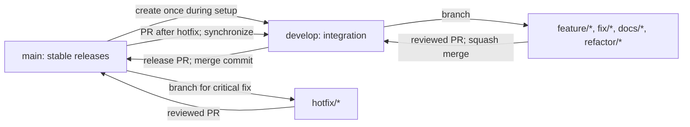

# Contributing to Meeting Minutes Assistant (MVP)

This guide defines the Git and GitHub workflow for the three developers working on `se2026-t15`. Use GitHub Issues to track work and Pull Requests (PRs) to review changes. **MUST** and **MUST NOT** are requirements; **SHOULD** is a strong recommendation that can be set aside for a good reason; **MAY** is optional.

**Table of contents**

1. [Branch Strategy](#1-branch-strategy)
2. [Branch Naming Convention](#2-branch-naming-convention)
3. [Commit Convention](#3-commit-convention)
4. [Development Workflow](#4-development-workflow)
5. [Pull Request Rules](#5-pull-request-rules)
6. [Code Review Rules](#6-code-review-rules)
7. [Merge Strategy](#7-merge-strategy)
8. [Branch Cleanup](#8-branch-cleanup)

## 1. Branch Strategy

We use a simplified Git Flow: `develop` collects reviewed work, while `main` holds stable, release-ready code. Short-lived work branches keep changes isolated until review.

If `develop` does not yet exist, the repository owner creates it once from `main` in GitHub before contributors begin work.

| Branch | Purpose | Base branch |
| --- | --- | --- |
| `main` | Stable, release-ready code | — |
| `develop` | Main integration branch for the next release | `main` when first created |
| `feature/*` | New functionality | `develop` |
| `fix/*` | Bug fixes outside a production hotfix | `develop` |
| `docs/*` | Documentation changes | `develop` |
| `refactor/*` | Code restructuring without intended behavior changes | `develop` |
| `hotfix/*` | Critical fixes to code already released from `main` | `main` |



- `main` **MUST** contain stable, release-ready code. `develop` **MUST** be the main integration branch.
- Developers **MUST NOT** push directly to `main` or `develop`. Every change to either branch **MUST** arrive through a PR.
- `feature/*`, `fix/*`, `docs/*`, and `refactor/*` branches **MUST** start from and target `develop`.
- `hotfix/*` branches **MUST** start from `main`. A reviewed hotfix **MUST** be merged into `main`, then synchronized back into `develop` through a PR from `main` to `develop` so the fix remains in future releases.
- MVP releases **MUST** use a PR from `develop` into `main`. Release branches are not required for the initial MVP.

Traditional Git Flow adds long-lived release branches. For a three-person MVP, direct release PRs from `develop` provide a review point without another branch to maintain. Reserve `hotfix/*` for urgent problems in the released version; routine bugs belong on `fix/*`.

## 2. Branch Naming Convention

Name branches `<type>/<issue-id>-<short-description>` when a related GitHub Issue exists. If there is no Issue, use `<type>/<short-description>`; never invent an Issue number. The `issue-id` is the numeric GitHub Issue number, and the description briefly identifies the task.

| Type | Use for |
| --- | --- |
| `feature` | New user-facing or internal functionality |
| `fix` | Non-production bug fixes |
| `docs` | Documentation changes |
| `refactor` | Code restructuring without intended behavior changes |
| `hotfix` | Critical production fixes |

Use lowercase English letters for words, digits for Issue numbers, and `kebab-case` for descriptions. Branch names **MUST NOT** contain spaces or unnecessary special characters. Keep names short, meaningful, and descriptive; use only the types above. Each branch **SHOULD** address one Issue or independent task, and unrelated tasks **MUST NOT** be combined. An existing related Issue number **MUST** appear in the branch name. Generic names such as `feature/test`, `fix/bug`, and `my-branch` are not acceptable.

Valid examples:

```text
feature/12-audio-upload
feature/13-whisper-transcription
feature/14-speaker-diarization
feature/15-meeting-summary
fix/21-incorrect-timestamp
fix/22-audio-validation
hotfix/30-upload-service-error
docs/31-update-readme
refactor/32-extraction-service
docs/update-contributing
```

| Invalid name | Why it violates the convention |
| --- | --- |
| `Feature/12-Audio-Upload` | Words and type must be lowercase. |
| `feature/12_audio_upload` | The description must use hyphens, and an Issue number must be separated from it by a hyphen. |
| `feature/12-audio upload` | Spaces are not allowed. |
| `feature/test` | The description does not identify a meaningful task. |
| `fix/bug` | The description is too generic. |
| `my-branch` | It lacks a supported type and a descriptive name. |

## 3. Commit Convention

Use [Conventional Commits](https://www.conventionalcommits.org/en/v1.0.0/). The format is `<type>(<scope>): <description>`, or `<type>: <description>` when the scope is omitted. A scope names the affected area, such as `audio`, `transcription`, or `extraction`.

| Commit type | Use for |
| --- | --- |
| `feat` | New features |
| `fix` | Bug fixes |
| `docs` | Documentation changes |
| `refactor` | Code restructuring without behavior changes |
| `test` | Added or modified tests |
| `chore` | Maintenance and configuration changes |
| `perf` | Performance improvements |
| `ci` | CI/CD changes |

Commit messages **MUST** be in English and use lowercase types and scopes. Descriptions **MUST** be concise and meaningful, and **SHOULD** start with an imperative verb. Use the type that describes the change: feature work on `feature/*` uses `feat`, while a hotfix on `hotfix/*` generally uses `fix`. Branch types and commit types are distinct; supporting test or documentation commits can use `test` or `docs` on a feature branch. Each commit **SHOULD** contain one logical change. Do not use vague descriptions such as `update`, `fix bug`, `done`, or `final`.

Valid examples:

```text
feat(audio): implement audio upload
feat(transcription): integrate whisper api
feat(diarization): add speaker labeling
feat(extraction): generate meeting summary
fix(transcript): correct segment timestamps
fix(temporal): resolve relative dates
docs: update contribution guidelines
refactor(extraction): simplify processing pipeline
test(audio): add upload validation tests
```

| Invalid message | Why it violates the convention |
| --- | --- |
| `feature(audio): implement audio upload` | `feature` is a branch type; the commit type is `feat`. |
| `Feat(Audio): Implement audio upload` | The type and scope must be lowercase. |
| `fix bug` | It lacks the required type separator and gives no useful detail. |
| `done` | It has no type and does not describe a change. |

For an incompatible change, append `!` after the type or scope and explain the impact in a `BREAKING CHANGE:` footer. For example:

```text
feat(api)!: change transcript response format

BREAKING CHANGE: clients must read segments from the transcript object.
```

## 4. Development Workflow

For a new audio upload feature, follow these steps. Start with a clean working tree so switching branches does not mix unrelated work.

1. Switch to the local integration branch:

   ```bash
   git switch develop
   ```

2. Update local `develop` from the remote. `--ff-only` avoids creating an accidental merge commit:

   ```bash
   git pull --ff-only origin develop
   ```

3. Create the feature branch from the updated `develop`:

   ```bash
   git switch -c feature/12-audio-upload
   ```

4. Implement the feature and run relevant tests.

5. Review local changes before staging:

   ```bash
   git status
   git diff
   ```

6. Stage and commit the logical change:

   ```bash
   git add .
   git diff --cached
   git commit -m "feat(audio): implement audio upload"
   ```

   Developers **SHOULD** inspect staged changes before committing and avoid staging unrelated files or secrets. If `git add .` stages too much, unstage the unwanted paths and stage only the intended files.

7. Push the feature branch:

   ```bash
   git push -u origin feature/12-audio-upload
   ```

8. Create a PR from `feature/12-audio-upload` into `develop`.

9. If reviewers request changes, continue on the same feature branch, commit the corrections, and push new commits. Address feedback in the existing PR; do not open another PR for the same task.

10. Once the PR is merged, update local `develop`:

    ```bash
    git switch develop
    git pull --ff-only origin develop
    ```

Step 2 updates the local `develop` branch. If work is still in progress and `develop` receives new commits, integrate its latest remote state **into the existing feature branch** instead:

```bash
git switch feature/12-audio-upload
git fetch origin
git merge origin/develop
```

Resolve any conflicts, run relevant tests, and push the branch. This merge-based approach preserves shared branch history and does not require a force push.

## 5. Pull Request Rules

| Source branch | Target branch | Purpose |
| --- | --- | --- |
| `feature/*` | `develop` | New feature |
| `fix/*` | `develop` | Routine bug fix |
| `docs/*` | `develop` | Documentation |
| `refactor/*` | `develop` | Refactoring |
| `develop` | `main` | MVP release |
| `hotfix/*` | `main` | Critical released-code fix |
| `main` | `develop` | Synchronize a merged hotfix |

Feature branches **MUST NOT** target `main` directly. Each PR **SHOULD** cover one task or Issue, and unrelated functionality **MUST NOT** be combined. PR titles **SHOULD** follow Conventional Commits when appropriate. PR descriptions **MUST** explain what changed and why, link a related Issue when applicable, and include testing instructions or evidence. UI changes **SHOULD** include screenshots when useful. AI pipeline changes **SHOULD** include relevant sample inputs and outputs when possible, with confidential information removed.

Draft PRs **MAY** be used for incomplete work, but **MUST NOT** be merged until marked ready and reviewed. Address requested changes in the same PR.

To open a PR in GitHub: **Repository → Pull requests → New pull request → select the base and compare branches → Create pull request**. Confirm the base and compare branches before submitting.

Example PR for `feature/12-audio-upload`:

| Field | Example |
| --- | --- |
| Base / compare | `develop` / `feature/12-audio-upload` |
| Title | `feat(audio): implement audio upload` |
| Why | Allow users to provide a meeting recording for transcription. |
| Changes | Add the upload flow and validate the selected audio file. |
| Issue | Related to #12. |
| Testing | Ran relevant automated tests; manually checked a valid upload and invalid-file feedback. |

## 6. Code Review Rules

With three developers, every PR **MUST** receive at least one approval from another team member before merging. Authors **MUST NOT** approve their own PRs. Important unresolved review comments **MUST** be addressed, unresolved merge conflicts **MUST** be cleared, and all required CI checks **MUST** pass if CI is configured. If CI is not configured, the author **MUST** manually perform relevant tests and document the results in the PR.

Changes targeting `main` **MUST** be approved as part of a team-agreed release, including urgent hotfixes. Reviewers **SHOULD** give constructive, actionable feedback and check:

- [ ] Does the change do what the PR and Issue describe?
- [ ] Is it understandable and maintainable?
- [ ] Are behavior and interfaces compatible with related work?
- [ ] Were relevant tests run, and are the results documented?
- [ ] Are there security or data-handling concerns, such as exposed secrets or sensitive meeting content?

GitHub review outcomes have different meanings:

| Outcome | Meaning |
| --- | --- |
| **Approve** | The changes meet the review requirements. |
| **Request changes** | Important issues must be resolved before approval. |
| **Comment** | Feedback or discussion without approval or a formal request for changes. |

These rules apply even if the repository has not yet been configured to enforce them automatically.

## 7. Merge Strategy

Use **Squash and Merge** for `feature/*`, `fix/*`, `docs/*`, and `refactor/*` PRs into `develop`. It leaves one integration commit per completed task, reduces noise from intermediate commits, and makes finished work easier to find. Check that the squash commit message follows the commit convention.

For a release PR from `develop` to `main`, prefer a **regular merge commit** to preserve the relationship between the integration and release branches. Merge hotfix PRs into `main` after review, then use a PR from `main` into `develop` to carry the fix forward. A regular merge commit is appropriate for this synchronization so both branches retain the hotfix ancestry.

Do not merge PRs with unresolved conflicts. Do not rewrite the history of protected branches or force push to `main` or `develop`. After resolving conflicts, rerun relevant tests and keep the resulting Git history understandable.

For example, if `feature/12-audio-upload` conflicts with new work on `develop`, resolve it on the feature branch:

```bash
git switch feature/12-audio-upload
git fetch origin
git merge origin/develop
git status
git diff --name-only --diff-filter=U
```

Git reports the conflicted files. Open each file, choose the intended combined content, and remove the conflict markers (`<<<<<<<`, `=======`, `>>>>>>>`). Then stage each resolved file and finish the merge:

```bash
git add path/to/resolved-file
git merge --continue
```

Run the relevant tests for the affected code, document the result in the PR, and push the updated branch:

```bash
git push origin feature/12-audio-upload
```

Repeat the resolution for every conflicted file before `git merge --continue`. Do not push the branch until the merge is complete and tests have passed.

## 8. Branch Cleanup

Completed work branches **SHOULD** be deleted after their PRs merge. The repository owner **SHOULD** enable GitHub's **Automatically delete head branches** option when appropriate. Before enabling it, protect `main` and `develop` against deletion: each can be the head branch of a PR in this workflow. After a merge, update local `develop` and remove obsolete local branches:

```bash
git switch develop
git pull --ff-only origin develop
git branch -d feature/12-audio-upload
```

`git branch -d` deletes only the local branch and refuses if Git cannot confirm it was merged. After **Squash and Merge**, Git may still consider the original feature branch unmerged because its individual commits were replaced by a squash commit. Only after verifying that the PR merged successfully and its intended changes are present in `develop`, use:

```bash
git branch -D feature/12-audio-upload
```

If the remote branch remains and is no longer needed, delete it with:

```bash
git push origin --delete feature/12-audio-upload
```

The `git branch` commands affect only your local repository; `git push origin --delete` removes the branch from GitHub for everyone. Developers **MUST NOT** delete `main` or `develop`, or any branch that contains unfinished or unmerged work.
