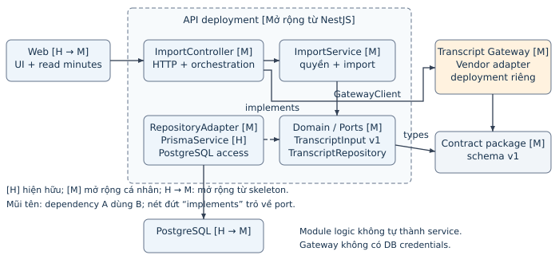
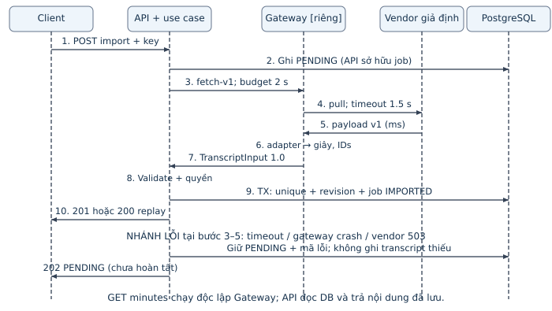

BÀI TẬP CÁ NHÂN 2 • AD-060

Nguyễn Huy Sơn · 23001922 · SE2026-T15 · VeinCodingAI-05 — Meeting Minutes Assistant tiếng Việt · Vai trò: Thành viên; phân tích cá nhân.

“Tôi chịu trách nhiệm về toàn bộ nội dung bài làm và đã khai báo việc sử dụng AI.”

Snapshot: main · commit 1bcbfc156671888a83da57dece19c1ac18b498e8Kiểm tra ngày 25/10/2026, 19:03 (UTC+7). Không có Lecture 04/05 được cung cấp; chưa đối chiếu thuật ngữ/slide. Không có .codegraph/.

Phạm vi bằng chứng

Hiện hữu [H]: NestJS chỉ có health, PrismaService và bảng Meeting ([[E7] apps/api/src/app.module.ts:1-9](https://github.com/vietquang8071/se2026-t15/blob/1bcbfc156671888a83da57dece19c1ac18b498e8/apps/api/src/app.module.ts#L1-L9); [[E1] apps/api/src/prisma.service.ts:5-15](https://github.com/vietquang8071/se2026-t15/blob/1bcbfc156671888a83da57dece19c1ac18b498e8/apps/api/src/prisma.service.ts#L5-L15); [[E2] packages/database/prisma/schema.prisma:10-16](https://github.com/vietquang8071/se2026-t15/blob/1bcbfc156671888a83da57dece19c1ac18b498e8/packages/database/prisma/schema.prisma#L10-L16)). Compose chỉ chạy PostgreSQL ([[E6] docker-compose.yml:1-20](https://github.com/vietquang8071/se2026-t15/blob/1bcbfc156671888a83da57dece19c1ac18b498e8/docker-compose.yml#L1-L20)). Thiết kế [T]: transcript/jobs/LLM và xem–xuất biên bản trong [[E3] apps/llm-service/docs/llm-service-architecture.md:24-47](https://github.com/vietquang8071/se2026-t15/blob/1bcbfc156671888a83da57dece19c1ac18b498e8/apps/llm-service/docs/llm-service-architecture.md#L24-L47); [[E4] docs/feature-overview.md:106-126](https://github.com/vietquang8071/se2026-t15/blob/1bcbfc156671888a83da57dece19c1ac18b498e8/docs/feature-overview.md#L106-L126). Mở rộng [M]: toàn bộ thiết kế sau đây và scenario/ là bài cá nhân, chưa tích hợp repo. Snapshot gốc giữ nguyên.

A. Đúng ba architecture drivers

| ID / driver | Nguồn và lý do | Tác động lên thiết kế |
| --- | --- | --- |
| D1 — Availability khi tích hợp lỗi | AD-060; FC4 yêu cầu đọc/xuất kết quả. Lỗi nguồn mới không nên chặn kết quả đã lưu. | Tách lỗi gateway; GET minutes đọc DB, không gọi vendor. |
| D2 — Thay định dạng nguồn, giữ domain ổn định | Biến cố AD-060; [T] normalized transcript trong E3. Tránh sửa rule mỗi khi vendor đổi DTO. | Adapter chuyển ms → s; contract v1; domain dùng port. |
| D3 — Thay đổi có thể kiểm soát và rollback | Boundary AD-060; phản hồi change request ≤22 giờ. 709 đồng thời, p95 ≤5 s, ops retention 70 ngày. | Deploy gateway riêng; schema additive; contract test và quy trình CR. |

01 Availability scenario — thiết kế đề xuất [M]

| Thành phần | Nội dung |
| --- | --- |
| Source → Stimulus | Gateway tích hợp mới → process crash/không trả lời khi đang lấy transcript. |
| Environment → Artifact | 709 người dùng/tác vụ đồng thời, giờ hoạt động bình thường; API, gateway, DB và chức năng xem biên bản đã lưu. |
| Response | API cô lập call bằng timeout 2 s; import giữ PENDING, cho retry có giới hạn. Người có quyền vẫn xem được biên bản đã lưu. Biên bản mới chờ transcript, chưa hoàn tất. |
| Measurable response | GET /meetings/:id/minutes: từ client gửi đến nhận đủ JSON hợp lệ, p95 ≤5.0 s trong cửa sổ fault 5 phút. Availability = số lượt đọc đúng 200 + đủ nội dung / toàn bộ lượt đọc hợp lệ được phát trong cửa sổ (kể cả timeout/5xx). Mục tiêu ≥99% là SLO tự đề xuất, chưa đo. |

Phạm vi: 709 là đồng thời, không phải request/giây. 202 PENDING không tính là hoàn tất import hay thành công Availability của biên bản mới. Mục tiêu 5 s áp dụng lượt đọc lõi; thời gian import phải đo riêng.


---

B. Module view và quyền sở hữu dữ liệu

[M] Thiết kế cá nhân: các khối H chỉ là skeleton hiện hữu, chưa có nghiệp vụ trong hình. Module view thể hiện dependency trong code; thứ tự runtime ở trang 3. Rule quyền nhập và revision bất biến thuộc API/domain; nhóm backend dự kiến sở hữu, chưa phải phân công đã duyệt.



| Module | Trách nhiệm / dependency được phép | Code thật hoặc vị trí dự kiến |
| --- | --- | --- |
| ImportController [M] | Auth, validate boundary; gọi use case + GatewayClient | apps/api/src/transcripts/controller.ts |
| ImportService / Domain [M] | Quyền meeting, revision bất biến; dùng TranscriptRepository port + input nội bộ | apps/api/src/transcripts/import-transcript.ts; scenario/use-case.ts |
| RepositoryAdapter [M] | Transaction, unique; implements port; dùng PrismaService [H] | apps/api/src/transcripts/repository.ts; E1 |
| Gateway + adapter [M] | Pull vendor, map dữ liệu; chỉ dùng contract v1 | apps/transcript-gateway/src/vtranscript-adapter.ts |
| Contract package [M] | Schema v1; không phụ thuộc SDK/Prisma | packages/transcript-contract/v1.json; scenario/contracts.ts |

Ownership logic — cùng một PostgreSQL, API là chủ lưu bền

| Dữ liệu / owner | Nguồn chuẩn; quyền đọc/ghi | Contract / cưỡng chế boundary |
| --- | --- | --- |
| Meeting + quyền / API | Meeting hiện hữu; owner/access là mở rộng. API đọc/ghi; UI chỉ qua HTTP. | API auth + kiểm quyền server; DB FK. |
| Revision + segments / API | Bảng Revision [M]; repository API ghi, UI đọc có quyền. Gateway chỉ giữ tạm trong RAM. | TranscriptInput 1.0; unique composite + transaction; gateway không có DB credentials. |
| Minutes đã lưu / API | Artifacts [T→M]; API ghi, UI đọc/export. LLM chỉ trả JSON. | GET minutes; API lọc theo meeting; không phụ thuộc gateway để đọc. |
| Job, log vận hành / API | ImportJob, logs [M]; API ghi. Gateway chỉ trả kết quả/mã lỗi chuẩn. | PENDING → IMPORTED/FAILED/EXPIRED; retention job/reference/log 70 ngày. |

Boundary [M]: private network + service token; chỉ repository dùng PrismaService. Domain không import SDK/DTO/Prisma. Chưa có enforcement trong repo gốc.


---

B. Runtime view, contract và invariant

[M] Luồng pull nguồn transcript mới; V-Transcript là vendor giả định, không phải tích hợp đã có. Nét mũi tên là lời gọi/dữ liệu theo thời gian, khác dependency ở trang 2.



Payload và contract v1

```typescript
Vendor: {format:"v1", document:"doc-7", revision:"r1",
 utterances:[{from_ms:12500,to_ms:18200,person:"speaker_1",
 content:"Thứ Sáu này nhóm sẽ demo."}]}
Nội bộ: {contract_version:"1.0", source_id:"vtranscript",
 external_id:"[\"doc-7\",\"r1\"]",
 segments:[{id:"seg-1",start:12.5,end:18.2,
 speaker_id:"speaker_1",text:"Thứ Sáu này nhóm sẽ demo."}]}
```

Trường trong ví dụ là bắt buộc; person/speaker_id được null. Adapter kiểm document/revision không trắng, 1–1000 đoạn, số hữu hạn, 0 ≤ start &lt; end, text không trắng. API kiểm lại canonical input và segment ID duy nhất; giữ text, speaker, thứ tự, cho phép overlap. source_id là namespace mờ, không phải DTO. Sample chưa mô tả đầy đủ duration/ordering của contract LLM: trước khi gọi LLM cần validate thêm theo contract đó.

Gateway POST /v1/fetch nhận reference và trả TranscriptInput 1.0 hoặc lỗi chuẩn; API không thấy mã lỗi SDK. Version major khác dùng /v2. 400 payload sai (không retry), 401/403 auth/quyền, 404 meeting, 409 cùng khóa khác nội dung, 503 store/gateway lỗi; API có thể giữ job và trả 202 PENDING khi gateway lỗi. Validate body ≤1 MiB là cấu hình minh họa.

Invariant I1 và transaction [M]

Mỗi (meeting_id, source_id, external_id) chỉ có một revision bất biến. external_id = JSON.stringify([document, revision]); cùng khóa+cùng segments trả 200 replay, khác segments trả 409, mới trả 201. Muốn sửa phải tạo revision mới. DB primary key + INSERT ON CONFLICT + so sánh jsonb trong transaction bảo vệ cạnh tranh; insert thất bại không để revision dở dang. Quyền chủ meeting kiểm ở use case và kiểm lại trong transaction (FOR SHARE khóa meeting).

Test gọi POST trực tiếp bỏ UI: user khác →403; hai request đồng thời →201 và 200, DB chỉ một dòng; cùng khóa khác text →409. Đã chạy trên HTTP harness + PostgreSQL tạm, chưa chạy NestJS. Quyền production phải lấy từ token được xác thực, không tin x-test-user của harness.

Retry: API là nơi quyết định; tối đa 3 lần thử tổng cho mỗi job (2 retry với backoff 1 s, 2 s + jitter), giữ khóa; chỉ transient. Gateway không tự retry. Hết budget giữ FAILED, người dùng tạo lượt thử mới có kiểm soát. Không cần event bus, không có cam kết exactly once. Retry/restart job bền và cập nhật job cùng transaction với revision là planned; sample mới chứng minh revision unique.


---

C. ADR-060-01 — Adapter và rollback độc lập

Trạng thái: Đề xuất cho bài cá nhân · 25/10/2026. Chưa được nhóm thông qua.

So sánh hai phương án triển khai cụ thể [M]

| Tiêu chí | A. Adapter trong process NestJS API | B. Gateway stateless riêng + API giữ DB |
| --- | --- | --- |
| Vendor / Availability | Cô lập qua interface nhưng crash/leak tài nguyên có thể ảnh hưởng API. | DTO nằm ở gateway; lỗi process có thể cô lập, API đọc DB độc lập. |
| Deploy / rollback | Ít image, nhưng đổi adapter phải rollout API. | Rollback gateway riêng; cần contract v1 tương thích. |
| Dữ liệu / transaction | Một process, API sở hữu transaction. | Không distributed transaction: gateway không ghi DB; API commit revision/job. |
| Vận hành / kiểm thử | Ít hạ tầng; unit test rẻ hơn. | Thêm HTTP, secrets, readiness và compatibility/fault test. |
| 22 giờ / năng lực | Dễ phản hồi CR nhỏ nhưng blast radius rộng. | Đánh giá đổi vendor trong phạm vi gateway; thêm chi phí phối hợp. Cả hai vẫn phải phản hồi CR ≤22 giờ. |

Context → Decision → Alternatives → Consequences

Context: D1–D3; API/database là skeleton ([[E1] apps/api/src/prisma.service.ts:5-15](https://github.com/vietquang8071/se2026-t15/blob/1bcbfc156671888a83da57dece19c1ac18b498e8/apps/api/src/prisma.service.ts#L5-L15); [[E2] packages/database/prisma/schema.prisma:10-16](https://github.com/vietquang8071/se2026-t15/blob/1bcbfc156671888a83da57dece19c1ac18b498e8/packages/database/prisma/schema.prisma#L10-L16)), [T] Web Backend sở hữu persistence và xử lý bên ngoài tách riêng ([[E3] apps/llm-service/docs/llm-service-architecture.md:24-47](https://github.com/vietquang8071/se2026-t15/blob/1bcbfc156671888a83da57dece19c1ac18b498e8/apps/llm-service/docs/llm-service-architecture.md#L24-L47)). Compose hiện chỉ có PostgreSQL. Chưa có benchmark hoặc thông tin năng lực DevOps; giả định nhóm có thể vận hành thêm một container.

Decision: chọn B cho nguồn mới: gateway chứa adapter; port TranscriptRepository ở domain API; shared canonical contract không chứa vendor DTO. Controller/use case/repository/GatewayClient deploy cùng image API; gateway image độc lập; Web image và DB độc lập. Không tách thêm service domain. API kiểm soát semantics/quyền, người phụ trách gateway dự kiến kiểm mapping; thay contract phải review cả hai phía.

Alternatives: A vẫn phù hợp MVP nếu không có hạ tầng container riêng; chưa chọn vì rollback adapter kéo theo API và khó chứng minh cô lập lỗi process. 709 đồng thời tự nó không chứng minh cần microservices. Consequences: B giảm phạm vi rollout nhưng thêm network failure và contract test; DB/API vẫn là điểm lỗi chung, gateway riêng không bảo đảm Availability toàn hệ thống.

Deployment boundary và quy trình rollback [M, planned]

Bảo vệ: CI chạy fixtures canonical v1 với gateway N và N−1, lint dependency rule; readiness gateway kiểm config/schema không gọi vendor, API readiness kiểm DB. Feature flag new_source_enabled tắt nguồn mới mà vẫn cho đọc minutes.

Kích hoạt: nếu canary lỗi contract/ghi trùng, rollback ngay; hoặc tỷ lệ import transient &gt;5% trong 5 phút (ngưỡng đề xuất) so với baseline cùng workload. Tắt nguồn mới, ngừng nhận job mới, drain call đang chạy tối đa 2 s; chuyển gateway image N về digest N−1 và config tương thích v1. Nếu lỗi ở API thì rollback API riêng; phải kiểm N−1 đọc schema mở rộng trước rollout.

Schema/data: expand–contract: thêm bảng revision/job/access, giữ Meeting.title/anchorDate; chưa xóa/đổi kiểu cột cũ. Rollback app không xóa dữ liệu. Request có thể đã commit dù timeout: tra cùng khóa rồi replay, không sinh revision mới. Production cần lease/attempt token để chỉ worker còn quyền được cập nhật job; N−1 không được ghi đè state mới. Chưa triển khai lease trong sample.

Xác minh: smoke GET minutes và import fixture v1; đọc revision/job đã ghi bởi N; retry call bị cắt → đúng một revision; kiểm FK/unique và không có job mất dấu. Trigger xem lại ADR: load/fault test vẫn không đạt core-read SLO hoặc vận hành gateway vượt nguồn lực đã thống nhất; thu latency, lỗi, restart/job-age để cân nhắc giới hạn concurrency, sửa DB/API hoặc quay A có kiểm soát.


---

D. Code quality — evidence, tác động, bước sửa

Module thật: PrismaService ([[E1] apps/api/src/prisma.service.ts:5-15](https://github.com/vietquang8071/se2026-t15/blob/1bcbfc156671888a83da57dece19c1ac18b498e8/apps/api/src/prisma.service.ts#L5-L15)) kết nối package database; schema ([[E2] packages/database/prisma/schema.prisma:10-16](https://github.com/vietquang8071/se2026-t15/blob/1bcbfc156671888a83da57dece19c1ac18b498e8/packages/database/prisma/schema.prisma#L10-L16)) chỉ có Meeting. Không có bằng chứng hàm nhập transcript dài trong commit gốc. [M] scenario/before.ts là hàm phát triển tiếp theo của API dự kiến, bản minh họa chưa commit; không gán code smell này cho repo.

| Vấn đề / Evidence | Risk / impact surface | Refactoring step → Regression safety |
| --- | --- | --- |
| Q1 — Cohesion thấp [M]<br>importTranscriptBefore trong before.ts trộn mapping/validation, quyền meeting và ghi dữ liệu. | Đổi input hoặc rule chạm cùng hàm; kiểm validation phải dựng repository; khó phân biệt lỗi mapping với store. | Extract mapVendorPayload; extract use case, giữ facade cũ. So sánh cả result, thứ tự call và side effect ở characterization tests. |
| Q2 — Vendor coupling [M]<br>Hàm nghiệp vụ đọc utterances/from_ms/person, tự ghép external_id. | Vendor đổi tên trường/đơn vị buộc sửa API nghiệp vụ; map sai làm ảnh hưởng timestamps và revision key. | Sau extract, di chuyển adapter ra gateway, chỉ truyền TranscriptInput. Đây là đổi boundary riêng sau refactor. Contract fixture ms→s, null speaker; test lỗi version/payload. |
| Q3 — Information hiding chưa có boundary [H]<br>PrismaService.client public readonly (E1:7); AppModule cung cấp service (E7). | readonly chỉ cấm gán lại biến, không cấm caller ghi mọi model. Khi phát triển, use case có thể bỏ qua unique/rule và coupling vào Prisma. Đây là nguy cơ mở rộng, chưa có caller sai được xác nhận. | Giới hạn truy cập client trong repository adapter; domain import port. Không dựng wrapper toàn DB. Dependency check + integration I1; quy tắc import còn planned. |

Before: một hàm mang ba lý do thay đổi [M]

Trích nguyên văn before.ts:10–15 (validation), 23–27 (mapping) và 28–37 (rule/persistence/error). Các khoảng giữa được bỏ, không phải toàn bộ hàm.

```typescript
    if (!payload || payload.format !== 'v1' || typeof payload.document !== 'string' ||
        !payload.document.trim() || typeof payload.revision !== 'string' ||
        !payload.revision.trim() || !Array.isArray(payload.utterances) ||
        payload.utterances.length === 0 || payload.utterances.length > 1000) {
      throw new InputError('BAD_VENDOR_PAYLOAD');
    }
```

```typescript
      return { id: `seg-${index + 1}`, start: item.from_ms / 1000,
        end: item.to_ms / 1000, speaker_id: item.person, text: item.content };
    });
    const input: TranscriptInput = { contract_version: '1.0', source_id: 'vtranscript',
      external_id: JSON.stringify([payload.document, payload.revision]), segments };
    // Business rule: chỉ chủ cuộc họp được nhập transcript.
    const owner = await repository.ownerOf(meetingId);
    if (owner === null) return { status: 404, body: { code: 'MEETING_NOT_FOUND' } };
    if (owner !== actor) return { status: 403, body: { code: 'FORBIDDEN' } };
    // Persistence: transaction chống trùng và kiểm lại quyền tại DB.
    const result = await repository.save(meetingId, actor, input);
    return result;
  } catch (error) {
    if (error instanceof InputError) return { status: 400, body: { code: error.message } };
    return { status: 503, body: { code: 'STORE_UNAVAILABLE' } };
```

Source đầy đủ là scenario/before.ts (hàm dòng 5–39). Validation và mapping nằm trước kiểm quyền; rule quyền nằm ở hai nhánh 404/403; persistence nằm ở repository.save. Mùi thiết kế đến từ trách nhiệm trộn lẫn, không phải chỉ do số dòng.

Ranh giới của refactoring

Bước 1 chỉ extract hai trách nhiệm trong cùng process, giữ facade và repository transaction cũ. Bước 2 chuyển process và thêm boundary validator, auth, job lifecycle/timeout: đây là thay đổi kiến trúc/behavior cần test riêng. Không lấy test của bước 1 để kết luận bước 2 an toàn trên production.


---

D–E. After, regression safety và technical debt

After: extract function, giữ facade nhận payload cũ [M]

```typescript
export async function importTranscriptAfter(
  payload: any, meetingId: string, actor: string, repository: TranscriptRepository,
): Promise<Result> {
  try {
    const input = mapVendorPayload(payload);
    return await importTranscript(input, meetingId, actor, repository);
  } catch (error) {
    if (error instanceof InputError) return { status: 400, body: { code: error.message } };
    return { status: 503, body: { code: 'STORE_UNAVAILABLE' } };
  }
}
```

Code đầy đủ: scenario/after.ts, use-case.ts, adapter.ts, contracts.ts. Observable behavior giữ nguyên: input facade, status/code, text và đơn vị, thứ tự validation → quyền → save, một lần save với transaction cũ. Adapter lỗi vẫn 400 trước khi đọc owner; store lỗi vẫn 503. Refactoring không tự thêm retry hoặc migration.

Characterization trước khi nhóm sửa sản phẩm

| Case / contract cần giữ | Kiểm tra thực trong sample |
| --- | --- |
| Thành công; input sai; timestamp/text sai; thiếu meeting; sai quyền; store lỗi | 7 case so result/status/body, rows và call order giữa before/after. Có input sai + actor sai để giữ thứ tự lỗi. |
| Retry cùng khóa; cùng khóa khác body | 201 →200 →409; không có side effect ghi đè. |
| HTTP/server + DB | 6 integration/fault tests: bypass UI, input sai, cạnh tranh, conflict, quyền tại save, gateway timeout/recovery. |

Kết quả đã chạy: 2026-10-25T19:16:36 (UTC+7), Node 25.8.2, PostgreSQL 17-alpine trong container tạm: 11 unit/characterization + 6 integration = 17 passed, 0 failed. DB cuối có một revision. Minutes là fixture; job state trong RAM, không chứng minh restart bền. Lần chạy đầu vướng readiness Postgres đang shutdown sau init; đã đổi probe TCP rồi chạy lại đạt. Log giữ cả lần lỗi và lần đạt.

Technical debt register [M trừ DQ3 có evidence H]

| ID / Debt và evidence | I/U/E | Ưu tiên | Trả nợ / tiêu chí xong |
| --- | --- | --- | --- |
| DQ1 — MVP sample dùng job RAM, chưa lease; server.ts. Quyết định tạm để test lỗi nhanh. | 5/5/3 | 1 | Persist PENDING/attempt; lease và atomic commit revision/job. Restart/retry không mất job, không ghi trùng. |
| DQ2 — Gateway rollout mới là kế hoạch; giữ v1 fixture thủ công trước khi có CI. | 4/4/2 | 2 | Contract matrix N/N−1 + canary/rollback drill trên staging; state/schema cũ đọc được. |
| DQ3 — Cho future use case dùng trực tiếp public client là shortcut có chi phí coupling; E1:7. | 3/3/2 | 3 | Chỉ repository import PrismaService; lint boundary và direct-API invariant tests đạt. |

I/U/E lần lượt là Impact/Urgency/Effort 1–5; 5 = tác động lớn/khẩn cấp cao/công sức lớn. Không dùng công thức. DQ1 ưu tiên vì mất job khi lỗi; DQ2 vì rollback là boundary trọng tâm; DQ3 xử lý cùng mở rộng API để tránh lan coupling. Chưa xây tính năng tự nó không phải debt: các mục nêu shortcut tạm và chi phí phát sinh cụ thể, chưa phải quyết định của nhóm.


---

F. AI-assisted review, traceability và kiểm chứng

AI lưu nguyên văn đề xuất sơ bộ trước khảo sát trong evidence/ai_initial.txt, sau đó đối chiếu source (evidence/ai_review.txt). Bảng dưới là thay đổi thực trong phiên; chưa có bước “sinh viên đã xác nhận”.

| Đề xuất ban đầu | Evidence kiểm chứng | Sửa / phương án cuối |
| --- | --- | --- |
| Dùng module transcript đã có | E7 chỉ có AppController/PrismaService; E2 chỉ có Meeting. | Sửa: điểm xuất phát là PrismaService; importTranscript được gắn nhãn M. |
| Đặt adapter cùng API để đơn giản | E3 mô tả xử lý ngoài và API sở hữu DB; AD-060 ưu tiên availability/rollback. | Sửa lựa chọn sơ bộ: gateway riêng, chấp nhận thêm vận hành; chưa phải kết luận bắt buộc từ repo. |
| Unique meetingId + externalId | E5 phân biệt source revision và retry; nhiều nguồn có thể cùng document ID. | Sửa khóa: meeting + source + [document,revision]; conflict không ghi đè. |

Traceability — các test planned ngoài phạm vi đã chạy được ghi rõ

| Driver / yêu cầu | Decision / boundary → code | Test và kết quả mong đợi |
| --- | --- | --- |
| D1 Availability | ADR-060-01; server.ts [M] | Đã chạy timeout + read fixture; staging fault planned: core read thành công, import PENDING. |
| D2 Adapter | Gateway/v1 → adapter.ts, contracts.ts [M] | Đã chạy mapping/bad payload; planned lint domain không import vendor DTO/SDK. |
| D3 Rollback | Gateway N/N−1; expand–contract [M] | Planned: image/config rollback, cũ đọc/ghi schema, retry job cũ không mất/trùng. |
| I1 invariant | API + repository; schema.sql [M] | Đã chạy HTTP cạnh tranh 201/200; conflict 409, actor khác 403. |
| Retention 70 ngày | API ops log/job/reference; retention.ts [M] | Đã chạy fake clock tại đúng biên 70 ngày; planned purge ops và xử lý job chờ trên DB tạm. |
| CR phản hồi ≤22 giờ | Checklist: nhận CR → phân loại tác động → trả lời người gửi [M] | Planned: ghi received_at/responded_at; xác minh phản hồi ≤22 giờ, không phải triển khai xong/RTO. |

Kế hoạch đo tải và giữ dữ liệu [M, chưa chạy]

Load: staging riêng dự kiến 8 vCPU/16 GiB (giả định, phải ghi cấu hình thực khi chạy), API/gateway/DB và generator tách tài nguyên. Seed 100 biên bản tổng hợp khoảng 100 KiB/bản; 709 virtual users vòng kín, 1 s think time, 90% đọc minutes/10% import reference đã seed. Warm-up 2 phút, đo 10 phút; ngắt gateway phút 3–8. Ghi concurrency thực, số request phát/hoàn tất, timeout, status và kiểm nội dung. p95 nearest-rank trên thời gian end-to-end của core read thành công; đồng thời báo success/total và timeout để không che lỗi nhanh. Đo latency/import completion riêng, không lấy ACK làm hoàn tất. Không chạy trên vendor thật.

Retention: 70 ngày cho log vận hành, job metadata và remote references, không mặc nhiên cho audio/transcript/artifacts. Ở ngày 69 cảnh báo job chờ; tại 70 đánh EXPIRED, bỏ reference nhạy cảm và purge theo policy, không retry vô hạn. Dedupe key của revision đi cùng dữ liệu nghiệp vụ, không xóa theo log; policy nghiệp vụ cần nhóm duyệt. Test hiện chỉ lọc bản sao với thời gian giả lập.

Trade-off: retry tăng Availability nhưng tăng latency, tải và nguy cơ ghi trùng; cân bằng bằng timeout, một tầng retry hữu hạn và unique key. API/DB lỗi vẫn làm core read gián đoạn. Cần sinh viên xác nhận: giải thích I1/refactor/rollback; thống nhất với nhóm core-read SLO, auth/ownership và retention; đối chiếu slide khi có. PDF này không chứng minh production đạt 709 hay p95 5 s.


---

PHỤ LỤC • AI Usage Log (ngoài 7 trang chính)

Công cụ: Codex, phiên tương tác ngày 25/10/2026. Model ID/phiên bản cụ thể không được cung cấp để kiểm chứng; không đoán. Người dùng đưa đường dẫn PROMPT_BT2_23001922_AD-060.md; AI đọc file làm prompt chính. AI khảo sát repo bằng Git/shell, kiểm tra GitHub bằng công cụ web, tạo code/tests, hai SVG vector và PDF bằng ReportLab. Không dùng sub-agent.

Mục đích: hỗ trợ khảo sát kiến trúc, tạo kịch bản mở rộng AD-060, so sánh phương án, refactoring và soạn báo cáo. Không push/PR/email/nộp bài. Sinh viên chưa xác nhận nội dung trong phiên.

1. Output sơ bộ nguyên văn, lưu trước khi khảo sát source

Đề xuất sơ bộ của AI trước khảo sát source — 2026-10-25

Giả định cần kiểm chứng: API đã có use case quản lý transcript và schema lưu transcript; cấu hình Compose thể hiện ranh giới triển khai hiện tại.

1. Lấy module transcript của API làm điểm xuất phát, bổ sung adapter nhận payload vendor giả định V-Transcript v1 và chuẩn hóa thành TranscriptInput.

2. Tạm ưu tiên triển khai adapter cùng API để giảm chi phí vận hành và giữ một transaction khi ghi transcript; rollback bằng phiên bản image API trước đó và cờ cấu hình tắt nguồn mới. Cần kiểm tra khả năng cô lập lỗi của cách này so với chức năng lõi.

3. Đề xuất invariant: một bản ghi transcript cho mỗi cặp meetingId + externalId, cưỡng chế unique constraint; cần đối chiếu mô hình dữ liệu và ownership thực tế trước khi chọn khóa cuối cùng.

4. Hàm before minh họa sẽ trộn validation, rule và persistence; bước refactoring đầu chỉ extract các hàm nội bộ để giữ hành vi, còn idempotency/triển khai riêng là thay đổi thiết kế sau đó.

Đây là đầu ra sơ bộ thực của AI, chưa được sinh viên xác nhận, không phải mô tả repository.

2. Output review nguyên văn sau kiểm chứng

AI tự review sau khảo sát source — 2026-10-25

1. Sửa điểm xuất phát: không có transcript use case trong API. app.module.ts chỉ khai báo AppController và PrismaService; schema.prisma chỉ có Meeting. Chọn PrismaService/package database làm module thật, còn importTranscript là phần mở rộng riêng trong scenario/.

2. Sửa ranh giới triển khai: đề xuất sơ bộ đặt adapter cùng API giảm vận hành, nhưng architecture document §§1.2–2.1 đặt Audio Processing tách biệt và Web Backend điều phối. Với AD-060 tập trung cô lập lỗi/rollback, chọn Transcript Gateway stateless độc lập cho nguồn transcript mới; API vẫn sở hữu DB. Đây là đề xuất bài cá nhân, Compose gốc chưa có các app containers.

3. Sửa invariant chống trùng: meetingId + externalId chưa phân biệt nhiều nguồn hoặc revision. Contract LLM §2.5 và §3 dùng transcript.revision_id, có retry và revision bất biến. Chọn (meetingId, sourceId, externalId), trong đó adapter tạo externalId từ [document, revision]. Khóa là đề xuất mới, không phải schema đã có. Nội dung thay đổi cùng khóa phải trả 409, muốn sửa dùng revision mới.

4. Giữ extract function trước khi di chuyển deployment. Không gọi việc chuyển process, thêm HTTP validation, timeout hoặc job lifecycle là refactoring giữ behavior.

Các bước trên do AI đối chiếu file bằng công cụ; chưa có xác nhận của sinh viên hoặc nhóm.

3. Việc dùng, kiểm tra và giới hạn

Đã dùng: hướng extract function, canonical contract, gateway độc lập và khóa revision đã sửa. Bảng sửa/bác bỏ ở trang 7 là kết quả AI tự đối chiếu; không ghi thành phản biện đã được sinh viên làm. Evidence module gốc tách khỏi scenario/; source chính thức không bị chỉnh sửa.

Đã chạy: Git clone/branch/commit, đọc source/schema/config/docs; 17 tests local; real PostgreSQL chỉ trong container tạm không volume/port public; fixture vendor synthetic. Lần đầu probe sớm khiến psql gặp “database system is shutting down”; sửa probe TCP, chạy lại 17/17. evidence/test-output-initial-failure.txt giữ lần lỗi; test-output.txt và test-results.json giữ lần đạt.

Kiểm tra PDF được ghi riêng tại evidence/pdf-check.json và preview trong report/previews/ sau khi xuất: font tiếng Việt, số trang, vị trí nội dung, hai sơ đồ, links. Không lấy kiểm tra bố cục làm xác nhận tính đúng học thuật. Chưa chạy: NestJS chính thức, vendor thật, staging deployment/rollback/migration compatibility, durable jobs, 709-user load/p95. Không có Lecture 04/05.

Sinh viên cần đọc toàn bộ 7 trang chính, mở source/fixtures, tự giải thích: vì sao ACK không là hoàn tất; vì sao cần source/revision trong unique key; extract function giữ gì; rollback app khác undo data thế nào. Cần nhóm xác nhận assumption về quyền, hạ tầng, SLO/retention và contract. Không có câu trả lời tự luyện giả mạo của sinh viên trong log.

4. Tái hiện và evidence

Commit chính thức: 1bcbfc156671888a83da57dece19c1ac18b498e8. Manifest file hash/thời gian: evidence/snapshot.json. Source có số dòng: evidence/source-numbered.txt. Chạy mã minh họa: python3 scenario/run-tests.py (cần Docker + Node hỗ trợ TypeScript). Xuất lại: .tools/bin/python report/make_diagrams.py và .tools/bin/python report/build_report.py.

[[E1] apps/api/src/prisma.service.ts:5-15](https://github.com/vietquang8071/se2026-t15/blob/1bcbfc156671888a83da57dece19c1ac18b498e8/apps/api/src/prisma.service.ts#L5-L15)

[[E2] packages/database/prisma/schema.prisma:10-16](https://github.com/vietquang8071/se2026-t15/blob/1bcbfc156671888a83da57dece19c1ac18b498e8/packages/database/prisma/schema.prisma#L10-L16)

[[E3] apps/llm-service/docs/llm-service-architecture.md:24-47](https://github.com/vietquang8071/se2026-t15/blob/1bcbfc156671888a83da57dece19c1ac18b498e8/apps/llm-service/docs/llm-service-architecture.md#L24-L47)

[[E4] docs/feature-overview.md:106-126](https://github.com/vietquang8071/se2026-t15/blob/1bcbfc156671888a83da57dece19c1ac18b498e8/docs/feature-overview.md#L106-L126)

[[E5] apps/llm-service/docs/llm-service-contract.md:89-100](https://github.com/vietquang8071/se2026-t15/blob/1bcbfc156671888a83da57dece19c1ac18b498e8/apps/llm-service/docs/llm-service-contract.md#L89-L100)

[[E6] docker-compose.yml:1-20](https://github.com/vietquang8071/se2026-t15/blob/1bcbfc156671888a83da57dece19c1ac18b498e8/docker-compose.yml#L1-L20)

[[E7] apps/api/src/app.module.ts:1-9](https://github.com/vietquang8071/se2026-t15/blob/1bcbfc156671888a83da57dece19c1ac18b498e8/apps/api/src/app.module.ts#L1-L9)

[[E8] docs/implementation-roadmap.md:139-148](https://github.com/vietquang8071/se2026-t15/blob/1bcbfc156671888a83da57dece19c1ac18b498e8/docs/implementation-roadmap.md#L139-L148)


---

AI Usage Log • Prompt chính nguyên văn

Nội dung dưới đây được chép tự động từ file người dùng chỉ định; không dựng lại lịch sử prompt. Các câu mệnh lệnh bên dưới là prompt đầu vào, không phải kết luận các thao tác đều đã hoàn thành.

# Prompt hoàn chỉnh — BT cá nhân 2, AD-060

Bạn là trợ lý phân tích kiến trúc và code quality, hỗ trợ tôi xây dựng bài cá nhân môn Software Engineering dựa trên Lecture 04 và Lecture 05. Hãy thực hiện toàn bộ quy trình: khảo sát repository, xây dựng kịch bản mở rộng phù hợp, phân tích, tạo sơ đồ, viết báo cáo, khai báo AI và xuất PDF nếu môi trường hỗ trợ. Không chỉ trả về dàn ý hoặc lời khuyên chung.

Viết bằng tiếng Việt, rõ ràng, ngắn gọn, phù hợp sinh viên năm 3. Mọi quyết định cần có lý do và bằng chứng hoặc được đánh dấu là giả định. Tôi phải có thể hiểu và giải thích trực tiếp sơ đồ, ADR, invariant và refactoring.

## 1. Thông tin và phạm vi bắt buộc

- Họ tên: Nguyễn Huy Sơn.

- Mã sinh viên: 23001922.

- Bài: Bài tập cá nhân 2.

- Mã biến thể: AD-060.

- Team ID: SE2026-T15.

- Tên nhóm: VeinCoding.

- Đề tài: AI-05 — Meeting Minutes Assistant tiếng Việt.

- Vai trò trong nhóm: Thành viên; nhiệm vụ trong bài là phân tích dự án, không tự nhận là trưởng nhóm hoặc kiến trúc sư của nhóm.

- Repository chính thức: https://github.com/vietquang8071/se2026-t15.

- Biến cố kiến trúc: Một tích hợp mới dùng định dạng dữ liệu khác; hệ thống phải thêm adapter mà không lan truyền chi tiết vendor vào domain.

- Boundary trọng tâm: deployment boundary và rollback.

- Code smell bắt buộc: hàm dài trộn validation, business rule và persistence.

- Quality attribute trọng tâm: Availability — duy trì chức năng lõi khi một thành phần lỗi.

- Tải: 709 người dùng/tác vụ đồng thời.

- p95 mục tiêu: không quá 5.0 giây.

- Dữ liệu vận hành lưu: 70 ngày.

- Thời hạn nhóm phản hồi change request: 22 giờ.

- File nộp: `BT2_23001922_AD-060.pdf`.

- Tối đa 7 trang nội dung chính; phụ lục AI Usage Log không tính vào giới hạn này. Không tạo trang bìa riêng làm tăng số trang không cần thiết.

Trang đầu phải có họ tên, mã sinh viên, biến thể, Team ID, mã đề tài, commit hash hoặc ngày kiểm tra repository, và nguyên văn cam kết:

“Tôi chịu trách nhiệm về toàn bộ nội dung bài làm và đã khai báo việc sử dụng AI.”

Đây là bài cá nhân. Hãy tạo sơ đồ, ADR, debt register và phân tích riêng từ code/requirements; không sao chép bài của thành viên khác. Không tự nộp bài, gửi email, tạo PR hoặc push lên repository.

## 2. Quyền xây dựng kịch bản mở rộng và quy tắc evidence

Repository hiện chưa hoàn thành. Tôi cho phép bạn tự đề xuất và bổ sung hàm, module, contract, failure case và dữ liệu mẫu cho một kịch bản phát triển tiếp theo, miễn hợp lý với đề tài và AD-060. Không cần dừng lại xin phép chỉ vì thiếu hàm nghiệp vụ trong code hiện tại.

Phải phân biệt rõ ba loại nội dung:

1. **Hiện trạng đã kiểm chứng:** file/code/config thực sự tồn tại ở snapshot repository được kiểm tra.

2. **Thiết kế trong tài liệu:** requirement, roadmap, contract hoặc kiến trúc đã được mô tả nhưng chưa chắc đã triển khai.

3. **Kịch bản mở rộng của bài cá nhân:** hàm/module/vendor/contract/test do bạn bổ sung để phân tích AD-060.

Trong báo cáo, ghi nhãn ngay tại đoạn hoặc hình có phần mở rộng. Có thể dùng một chú thích chung rõ ràng cho cả phần, tránh lặp nhãn ở mọi câu. Không mô tả code giả định là code đã có trên repository chính thức.

Rubric yêu cầu chọn feature/module có thật: vì vậy phải chỉ ra ít nhất một module thật làm điểm xuất phát, dẫn file và snapshot của module đó. Nếu dùng hàm bổ sung để phân tích code smell, ghi rõ đây là hàm trong kịch bản phát triển tiếp theo của module này, không phải lỗi đã xác nhận trong commit gốc. Tách evidence của module gốc và evidence của phần minh họa. Không khẳng định toàn bộ code smell tồn tại trong repo gốc nếu thực tế không có.

Nếu có công cụ tạo file, đặt mã minh họa trong thư mục riêng như `scenario/`, kèm đường dẫn module đích dự kiến. Giữ snapshot chính thức nguyên trạng. Nếu chỉ viết trong báo cáo, ghi “đường dẫn dự kiến” cho file chưa tồn tại. Không tạo commit hash giả; chỉ ghi hash của commit thực sự đọc được. Có thể dùng ngày kiểm tra và mã phiên bản minh họa riêng nếu phần bổ sung chưa được commit.

Không bịa số dòng, test đã chạy, số đo tải, p95, lịch sử rollback, sự cố production, quyết định của nhóm hoặc kết quả con người đã xác nhận. Kế hoạch kiểm thử phải ghi “planned”; chỉ ghi “passed/failed” khi đã chạy thật và có kết quả. Tài liệu thiết kế không phải bằng chứng tính năng đã hoạt động.

Nếu có Lecture 04 và Lecture 05, đọc và dùng đúng thuật ngữ của giảng viên, dẫn trang/slide khi cần. Nếu chưa có, tiếp tục bằng yêu cầu đề bài và kiến thức nền, ghi rõ chưa đối chiếu slide; không giả vờ đã đọc. Chỉ hỏi thông tin thực sự không thể suy luận; vẫn làm các phần độc lập trong lúc chờ.

## 3. Quy trình khảo sát và chọn kịch bản

### 3.1. Kiểm tra nguồn

- Kiểm tra repo local nếu có; nếu không, dùng GitHub hoặc bản clone tham chiếu riêng.

- Đọc hướng dẫn `AGENTS.md` áp dụng. Nếu repo có `.codegraph/`, ưu tiên CodeGraph để tìm hiểu code theo hướng dẫn repo; nếu không có thì bỏ qua.

- Ghi branch, commit SHA thực tế, ngày giờ kiểm tra và phạm vi đã đọc. Không nhầm Git tree SHA với commit SHA.

- Đọc cấu trúc, luồng chính, source, schema, cấu hình deploy và test hiện có; không chỉ đọc README.

- Với bằng chứng từ GitHub, ưu tiên permalink dạng `blob/&lt;commit&gt;/&lt;path&gt;#Lx-Ly` sau khi kiểm tra đúng số dòng. Có thể chỉ dẫn file/hash nếu chưa xác minh được số dòng.

- Nếu không truy cập được repo, nói đúng giới hạn; yêu cầu bản ZIP hoặc các file liên quan. Có thể tiếp tục phần thiết kế giả định, nhưng không tạo evidence repo chưa đọc.

Các đường dẫn khởi điểm cần kiểm tra lại, không coi mặc nhiên là còn đúng ở mọi snapshot:

- `README.md`, `docs/product-description.md`, `docs/feature-overview.md`, `docs/implementation-roadmap.md`.

- `apps/api/src/`, `apps/web/src/`.

- `packages/database/prisma/schema.prisma`, `packages/database/src/`.

- `apps/llm-service/docs/llm-service-architecture.md`, `apps/llm-service/docs/llm-service-contract.md`.

- `docker-compose.yml`, các `package.json` và cấu hình CI/deployment nếu có.

### 3.2. Chọn một kịch bản nhất quán

Sau khi đọc requirements, chọn một luồng nghiệp vụ phù hợp để dùng xuyên suốt toàn bài: drivers → module view → runtime view → ADR → code smell → refactoring → debt register → tests.

Có thể chọn tích hợp nguồn transcript mới có payload khác định dạng nội bộ. Đây chỉ là gợi ý; hãy đổi nếu code/requirements cho thấy luồng khác hợp lý hơn. Nếu đặt vendor giả định, ghi rõ là vendor của kịch bản, không phải tích hợp đã có.

Nếu chưa có hàm nghiệp vụ đủ để phân tích, được tạo một hàm minh họa “before” có tên dễ hiểu trong module mở rộng: nhận dữ liệu vendor, kiểm tra đầu vào/quyền truy cập, thực hiện business rule và ghi dữ liệu. Hàm phải thể hiện mùi thiết kế tự nhiên của một MVP, không cố kéo dài bằng code vô nghĩa. Sau đó thiết kế bản “after” với phạm vi refactoring nhỏ, dễ giải thích.

Giữ cùng một bộ tên module, operation, trạng thái và contract trong hai sơ đồ, ADR, code và test. Không bổ sung công nghệ hoặc abstraction chỉ để sơ đồ trông phức tạp.

## 4. Nội dung báo cáo theo rubric

### A. Architecture drivers và quality scenario — 20 điểm

Chọn đúng **3 architecture drivers quan trọng nhất**, có căn cứ từ requirements, quality attributes và constraints. Trình bày bảng: ID → driver → nguồn/evidence → vì sao quan trọng → tác động lên thiết kế. Phân biệt driver với giải pháp; tên công nghệ không tự nó là một driver.

Viết đúng **01 Availability scenario**, đủ 6 phần:

`Source → Stimulus → Environment → Artifact → Response → Measurable response`.

Scenario phải gắn với lỗi một thành phần trong kịch bản tích hợp mới, và giải thích chức năng lõi nào còn hoạt động, chức năng nào suy giảm hoặc phải chờ. Chức năng lõi phải có lý do từ requirement, không tự chọn một endpoint vô nghĩa chỉ để dễ đạt chỉ tiêu.

Sử dụng đúng cả bốn tham số và đúng ý nghĩa:

- **709** là mức đồng thời, không tự chuyển thành 709 request/giây.

- **p95 ≤ 5.0 giây:** xác định operation, điểm bắt đầu/kết thúc, tập request đo và điều kiện lỗi. Không coi phản hồi lỗi nhanh là Availability thành công. Nếu xử lý bất đồng bộ, phân biệt thời gian nhận job và thời gian hoàn thành nghiệp vụ; không dùng ACK nhanh để ngầm tuyên bố cả tác vụ đạt 5 giây.

- **70 ngày:** xác định phạm vi dữ liệu vận hành và chính sách retention; không mặc nhiên suy rộng thành giữ mọi audio/transcript trong 70 ngày. Nêu hệ quả với dữ liệu đang chờ xử lý khi thành phần lỗi.

- **22 giờ:** là thời hạn phản hồi change request; đặt đúng trong constraint/quy trình phản hồi liên quan. Không biến thành RTO, timeout hoặc thời hạn bắt buộc triển khai xong. Có thể chú thích constraint này ngay dưới bảng scenario để tránh nhét sai vào số đo Availability.

Nêu cách đo Availability khi xảy ra lỗi, tách khỏi latency: operation nào còn thành công, tử số/mẫu số và cửa sổ đo nếu đề xuất tỷ lệ thành công. Nếu bổ sung SLO, RTO hoặc ngưỡng khác, ghi rõ đó là mục tiêu thiết kế đề xuất, không phải số giảng viên đã cho hoặc số đã đo được.

Phân tích một xung đột cụ thể giữa Availability và quality attribute khác, gắn vào quyết định thực tế, ví dụ retry giúp chịu lỗi nhưng tăng latency và nguy cơ ghi trùng. Giải thích cách cân bằng và giới hạn còn lại.

### B. Module view, runtime view, boundary và ownership — 25 điểm

**Module view:**

- Tạo sơ đồ mới bằng Mermaid hoặc công cụ tương đương, tối thiểu 5 module/component có trách nhiệm riêng.

- Ghi chiều dependency và chú giải ý nghĩa mũi tên. Phân biệt dependency trong code với luồng gọi runtime.

- Chỉ ra business rule chính nằm ở đâu, ai sở hữu rule; domain không phụ thuộc trực tiếp SDK, DTO hoặc mã lỗi của vendor.

- Chỉ ra module thực có trong repo và module mở rộng. Module logic không mặc nhiên là một service/deployment riêng.

- Kèm bảng ngắn: module → trách nhiệm → dependency được phép → code hiện có hoặc vị trí dự kiến.

**Runtime view:**

- Thể hiện luồng request/event/data của tích hợp mới: nhận payload → adapter chuyển đổi → mô hình/contract nội bộ → use case/business rule → persistence/kết quả, điều chỉnh theo luồng đã chọn.

- Có happy path và ít nhất một failure path cụ thể: timeout, payload không hợp lệ, lỗi vendor, lỗi ghi dữ liệu hoặc lỗi sau triển khai.

- Vẽ điểm timeout, xử lý lỗi và hành vi suy giảm đúng với Availability scenario. Nếu có retry, ghi giới hạn và cách tránh xử lý trùng. Chỉ dùng queue/circuit breaker/fallback nếu giải thích được lợi ích và điều kiện cần.

- Thể hiện deployment boundary bằng nhãn hoặc grouping; mô tả rollback sau hình nếu cần để hình vẫn rõ trên A4.

**Ownership và contract:**

Lập bảng: dữ liệu → module sở hữu → nguồn lưu chính → bên được đọc/ghi → API/event contract → cơ chế cưỡng chế boundary. Nêu logical ownership nếu các module dùng chung database; không tự buộc phải tách database.

Đưa ví dụ payload vendor và contract nội bộ ngắn, đủ chứng minh adapter che giấu khác biệt. Nêu trường bắt buộc, validation, lỗi, versioning và semantics retry/idempotency khi có liên quan. Nếu dùng event, giải thích delivery, duplicate và ordering ở mức cần thiết; không tự khẳng định “exactly once”.

Với **deployment boundary và rollback**, phải trả lời cụ thể:

1. Thành phần nào deploy cùng nhau, thành phần nào độc lập, và lý do?

2. Hợp đồng nào đi qua ranh giới đó; ai kiểm soát thay đổi?

3. Cơ chế nào bảo vệ: contract test, dependency rule, readiness check, feature flag/config hoặc cơ chế khác thực sự phù hợp?

4. Tiêu chí nào kích hoạt rollback; rollback phiên bản/config nào; xác minh sau rollback ra sao?

5. Nếu schema/data đã đổi, bản cũ còn đọc/ghi được không? Có cần migration tương thích ngược hoặc expand–contract không? Phân biệt rollback ứng dụng với hoàn tác dữ liệu; không dùng xóa database hoặc restore mất dữ liệu làm giải pháp mặc định.

6. Xử lý request/job đang chạy và dữ liệu đã ghi thế nào, tránh mất hoặc ghi trùng?

Chỉ rõ ít nhất **01 invariant nghiệp vụ** phải bảo vệ ở server/database, gắn với luồng đã chọn. Giải thích chỗ kiểm tra, transaction/constraint nếu phù hợp, và test gọi trực tiếp API để chứng minh không thể vượt qua chỉ bằng cách bỏ UI. Nêu thêm test cạnh tranh hoặc retry nếu invariant có nguy cơ bị phá trong các trường hợp này.

### C. ADR và trade-off — 20 điểm

So sánh ít nhất **2 phương án phù hợp** bằng một bảng ngắn, dựa trên hiện trạng và kịch bản. Có thể là cách tổ chức layered với adapter, modular monolith, tách phần tích hợp thành worker/service, hoặc phương án khác có căn cứ. Không coi các thuật ngữ này luôn loại trừ lẫn nhau; so sánh những phương án triển khai cụ thể.

Các tiêu chí cần xét: cô lập vendor, Availability, deployment/rollback, dữ liệu và transaction, độ phức tạp vận hành, khả năng phản hồi change request trong 22 giờ, chi phí kiểm thử và năng lực nhóm. Phân biệt dữ kiện biết được với giả định về năng lực/hạ tầng.

Viết **01 ADR** gồm:

- ID, tên, trạng thái “Đề xuất cho bài cá nhân”, ngày.

- **Context:** vấn đề, evidence, drivers và constraints.

- **Decision:** chọn gì, adapter/port ở đâu, deployment boundary và rollback được tổ chức ra sao.

- **Alternatives:** phương án còn lại và lý do chưa chọn.

- **Consequences:** lợi ích, chi phí, rủi ro, giới hạn và debt mới nếu có.

Không viết như thể nhóm đã thông qua ADR. Không chọn microservices chỉ vì “dễ scale”. Tải 709 đồng thời tự nó chưa chứng minh phải dùng microservices.

Nêu **evidence trigger để xem lại quyết định**: đo đạc hoặc sự kiện nào sẽ cho thấy thiết kế không còn phù hợp, thu thập bằng cách nào, hành động đánh giá lại là gì. Nếu tự đề xuất ngưỡng hoặc khoảng thời gian quan sát, ghi rõ giả định; không tuyên bố có số đo khi chưa chạy.

### D. Code quality và refactoring — 20 điểm

Chọn feature/module thật trong repo và ghi đường dẫn, commit hash hoặc ngày kiểm tra. Mô tả ngắn hiện trạng và phần mở rộng đang phân tích.

Phân tích ít nhất **3 vấn đề riêng biệt** thuộc cohesion, coupling, information hiding, dependency direction hoặc technical debt. Bắt buộc có hàm dài trộn validation, business rule và persistence. Nếu hàm này do bạn tạo theo kịch bản, trích đúng bản “before” và ghi rõ nguồn minh họa.

Mỗi vấn đề trình bày đúng chuỗi:

`Evidence → Risk/impact surface → Refactoring step → Regression safety`.

- Evidence: file/hàm/đoạn code hoặc phần tài liệu; nêu nguồn thực hay minh họa.

- Risk/impact surface: thay vendor, sửa rule, lỗi persistence hoặc rollout sẽ ảnh hưởng operation/module nào và vì sao.

- Refactoring step: bước nhỏ, cụ thể, có thể thực hiện; không chỉ nói “áp dụng SOLID”.

- Regression safety: contract và test nào bảo vệ hành vi hiện tại.

Với hàm dài, chỉ rõ đoạn nào validation, đoạn nào business rule, đoạn nào persistence; giải thích trách nhiệm bị trộn gây khó kiểm thử và thay đổi ra sao. Không kết luận chỉ dựa vào số dòng hoặc gán một vấn đề thành ba mục để đủ số lượng.

Thiết kế **01 refactoring nhỏ before/after**:

- Đưa code hoặc trích đoạn đủ để đối chiếu; dùng ngôn ngữ/framework phù hợp repo.

- Ưu tiên extract function hoặc tách một trách nhiệm có lý do, giữ cấu trúc dễ đọc.

- Giữ observable behavior: input/output, HTTP status/error contract nếu có, quy tắc validation, side effect, thứ tự kiểm tra có ý nghĩa và transaction semantics.

- Nêu characterization/contract tests cần có **trước** khi sửa: thành công, dữ liệu lỗi, vi phạm rule/quyền, lỗi ghi dữ liệu và trường hợp retry/trùng nếu liên quan.

- Phân biệt cải tiến behavior với refactoring. Nếu thêm validation/idempotency/fallback làm thay đổi behavior, ghi thành bước thay đổi riêng sau refactoring; không gọi tất cả là “giữ nguyên behavior”.

- Trích đoạn vừa đủ cho PDF; nếu cần, lưu code đầy đủ trong file minh họa riêng.

### E. Technical debt register — 5 điểm

Tạo tối thiểu **3 mục**, có bảng:

`ID | Debt và evidence | Impact 1–5 | Urgency 1–5 | Effort 1–5 | Thứ tự | Hành động trả nợ/tiêu chí hoàn tất`.

Giải thích ngắn thang điểm: 5 là tác động lớn, khẩn cấp cao, hoặc công sức lớn tùy cột. Ưu tiên bằng lập luận dựa trên Availability, adapter và rollback; không cho điểm tùy ý. Nếu dùng công thức xếp hạng, công bố công thức và giải thích ngoại lệ có lý do. Không đánh đồng “chưa xây dựng” với technical debt nếu chưa có quyết định tạm bợ hoặc chi phí phát sinh tương ứng.

### F. AI-assisted review và traceability — 10 điểm

Thực hiện review AI trong chính quá trình làm bài, không viết một lịch sử sử dụng AI giả:

1. Tạo một phương án kiến trúc hoặc refactoring sơ bộ, nêu các giả định; lưu nguyên văn phần output liên quan trước khi chỉnh sửa.

2. Đối chiếu với source, requirements và AD-060; ghi nhận đề xuất giữ, sửa hoặc bác bỏ cùng evidence.

3. Thể hiện ít nhất **2 đề xuất AI đã sửa hoặc bác bỏ** khi có căn cứ thật, bằng bảng `Đề xuất ban đầu → Evidence kiểm chứng → Sửa/bác bỏ → Phương án cuối`. Có thể là thu hẹp phạm vi một đề xuất hợp lý sau khi xem code; không cần cố tình tạo đề xuất sai để rồi bác bỏ.

4. Nếu chưa có đủ 2 trường hợp có căn cứ, mở rộng review các giả định về contract, ownership, deployment, rollback hoặc test. Không bịa output cũ, lỗi AI hoặc sự xác nhận của sinh viên.

5. Ghi rõ bước nào do AI tự kiểm tra bằng công cụ, bước nào tôi cần đọc và xác nhận. Không viết “sinh viên đã kiểm chứng” nếu tôi chưa thực hiện.

Tạo traceability ngắn bằng bảng:

`Driver/requirement ID → Decision/boundary/ADR → Code location thật hoặc dự kiến → Planned test và kết quả mong đợi`.

Bao phủ ít nhất: Availability khi thành phần lỗi, adapter cô lập vendor, deployment/rollback, invariant, retention 70 ngày và constraint phản hồi change request 22 giờ. Dòng cuối có thể dẫn tới quy trình/checklist thay vì bịa một hàm xử lý SLA.

## 5. Kiểm thử và giới hạn bằng chứng

Tạo kế hoạch kiểm thử vừa đủ, bám theo traceability:

- Unit/contract test cho mapping vendor → contract nội bộ và lỗi định dạng.

- Test trước/sau refactoring để so sánh observable behavior.

- Integration test cho server/database invariant.

- Fault injection cho thành phần tích hợp lỗi, kiểm tra chức năng lõi còn hoạt động và tác vụ bị trì hoãn có trạng thái rõ ràng.

- Rollback smoke/compatibility test cho contract, schema, request/job đang xử lý và dữ liệu đã tồn tại.

- Load test ở 709 người dùng/tác vụ đồng thời, định nghĩa workload, duration, warm-up, dữ liệu, môi trường, tỷ lệ thành công và cách tính p95 ≤ 5.0 giây. Không chạy tải lớn lên dịch vụ thật hoặc phát sinh phí khi chưa được cho phép.

- Test retention bằng dữ liệu/thời gian giả lập; không xóa dữ liệu thật để kiểm tra mốc 70 ngày.

Chạy các kiểm tra an toàn có thể chạy trên local/sandbox nếu công cụ và dữ liệu cho phép. Nếu chưa chạy được, chỉ cung cấp test plan, expected result và lý do. Test dùng fake vendor chứng minh luồng nội bộ, không chứng minh vendor thật hoạt động hay production đạt tải.

## 6. Định dạng, sơ đồ và đầu ra

Tạo **01 file PDF duy nhất để nộp**, tên chính xác `BT2_23001922_AD-060.pdf`. Được lưu thêm source báo cáo, source sơ đồ và code minh họa để tôi chỉnh sửa, nhưng các file này không phải file nộp bổ sung.

Gợi ý phân bổ nội dung chính, được điều chỉnh nhưng không vượt 7 trang:

- Trang 1: thông tin bắt buộc, phạm vi/evidence, 3 drivers và Availability scenario.

- Trang 2: module view, trách nhiệm và ownership.

- Trang 3: runtime view, failure path, contract, deployment/rollback và invariant.

- Trang 4: so sánh phương án, ADR và điều kiện xem lại.

- Trang 5–6: 3 vấn đề code quality, before/after, regression safety và debt register.

- Trang 7: AI-assisted review, traceability và giới hạn kiểm chứng cần thiết.

Đây là ngân sách trang, không phải yêu cầu kéo dài đủ 7 trang. Không chuyển nội dung chấm điểm bắt buộc sang phụ lục AI Usage Log để né giới hạn trang.

Hai sơ đồ phải render thành hình thực sự, đọc được khi xem hoặc in A4; không chỉ dán mã Mermaid vào PDF. Giữ font và chú thích đủ rõ, ưu tiên vector, chia nhãn dài hợp lý. Kiểm tra bản PDF đã render về font tiếng Việt, cắt hình, bảng tràn trang, liên kết và số trang. Không thu nhỏ chữ quá mức để ép đủ trang.

Phụ lục **AI Usage Log** đặt sau nội dung chính trong cùng PDF, gồm:

- Công cụ/model nếu xác định được; không đoán model hoặc phiên bản.

- Ngày dùng, mục đích, prompt chính đã dùng và output trích nguyên văn vừa đủ.

- Phần output đã sử dụng; các đề xuất giữ/sửa/bác bỏ và lý do/evidence.

- Những việc đã kiểm tra bằng công cụ, chưa kiểm tra, và phần sinh viên cần xác nhận.

Giữ prompt chính đầy đủ trong log nếu cần để tái hiện; tránh lặp dài các câu trả lời không dùng. Không điền thời gian hoặc thao tác không thực sự diễn ra.

Nếu môi trường không xuất được PDF, tạo source hoàn chỉnh có thể xuất PDF, kèm lệnh/hướng dẫn ngắn và nói rõ chưa có PDF. Không giả vờ đã tạo hoặc kiểm tra file. Không dùng trình giữ chỗ cho những phần bạn có thể tự hoàn thành từ dữ liệu đang có.

## 7. Tự kiểm trước khi giao

Đối chiếu đủ 100 điểm của rubric, đặc biệt:

- Đúng 23001922, AD-060, SE2026-T15, AI-05; đúng tên file và cam kết.

- Đúng biến cố adapter, boundary deployment/rollback, smell hàm dài, Availability.

- Đúng 709 đồng thời; p95 ≤ 5.0 giây; retention 70 ngày; phản hồi change request trong 22 giờ.

- Đủ 3 drivers, 1 scenario/6 thành phần và một trade-off.

- Đủ 2 sơ đồ nhất quán, ≥5 module/component, dependency direction, rule/data ownership, contract, enforcement, failure path và server/database invariant.

- So sánh ≥2 phương án; ADR đủ 4 mục chính và evidence trigger để xem lại.

- Có module thật và file/snapshot evidence; ≥3 vấn đề; hàm dài được phân tích rõ; before/after giữ behavior; regression safety.

- Debt register ≥3 mục, đủ Impact/Urgency/Effort 1–5 và lý do ưu tiên.

- Có output AI thật, ≥2 đề xuất đã sửa/bác bỏ có evidence, traceability và AI Usage Log.

- Phần mở rộng luôn nhận diện được; không biến code giả định thành evidence của repo chính thức.

- Nội dung chính ≤7 trang; phụ lục AI cùng PDF; hai sơ đồ đọc được trên A4.

Chỉ kết luận đã hoàn thành những gì thực sự tạo và kiểm tra được. Không tự cho điểm tuyệt đối hoặc bảo đảm giảng viên chấp nhận phần kịch bản thay cho evidence code hiện hữu.

## 8. Bắt đầu và cách trả kết quả

Hãy bắt đầu bằng khảo sát repository, xác định module thật và chọn kịch bản mở rộng. Sau đó tiếp tục làm đến bộ đầu ra hoàn chỉnh, không dừng ở kế hoạch hoặc hỏi lại những thông tin tôi đã cung cấp. Khi làm lâu, cập nhật ngắn các phát hiện và giả định quan trọng.

Khi giao kết quả, cung cấp:

1. Link file PDF đã tạo, hoặc source xuất PDF nếu có giới hạn công cụ.

2. Link source báo cáo, hai sơ đồ và code minh họa nếu đã tạo.

3. Tóm tắt ngắn hiện trạng repo, kịch bản mở rộng và quyết định chính.

4. Các kiểm tra đã chạy cùng kết quả; tách khỏi planned tests.

5. Danh sách ngắn phần tôi cần đọc/xác nhận trước khi nộp; có thể kèm vài câu hỏi để tôi tự luyện giải thích bài.

Không tự nộp bài. Tôi sẽ kiểm tra nội dung và nộp một file PDF vào Assignment “Bài tập cá nhân 2” trên Google Classroom; không nộp thay bằng link GitHub.
