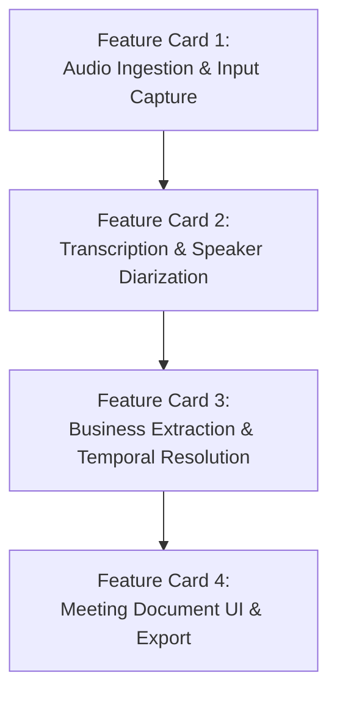

# Feature Cards & Task Breakdown: Meeting Minutes Assistant (MVP)

**Document Version:** 1.0  
**Target Milestone:** Minimum Viable Product (MVP)  
**Parent Document:** [docs/product-description.md](file:///home/chester/Documents/se2026-t15/docs/product-description.md)  
**Repository:** `se2026-t15`

---

## Overview

Dựa trên 6 nghiệp vụ kinh doanh đã thống nhất trong [Product Description](file:///home/chester/Documents/se2026-t15/docs/product-description.md), hệ thống MVP được phân chia thành **4 Feature Cards (Epic/Tính năng cốt lõi)** với các Task kỹ thuật cụ thể dưới đây:



---

## Feature Card 1: Audio Upload & Ingestion (Tải lên & Tiền xử lý Audio)

* **Mục tiêu:** Cho phép người dùng tải file audio cuộc họp đã có lên hệ thống và nhập ngày họp (Anchor Date) làm mốc thời gian.
* **User Story:** *"Là người dùng, tôi muốn tải file audio cuộc họp và nhập ngày họp để hệ thống tạo transcript và biên bản."*

### Danh sách Tasks kỹ thuật:
- [ ] **Task 1.1: Audio Upload Component & Validation**
  - Hỗ trợ các định dạng phổ biến: `.mp3`, `.m4a`, `.wav`, `.webm`.
  - Giới hạn mỗi file ở 100 MB; validate định dạng, hiển thị dung lượng file và độ dài (duration).
- [ ] **Task 1.2: Meeting Metadata Capture Form**
  - Thu thập thông tin bối cảnh cuộc họp:
    - Tiêu đề cuộc họp (`title`)
    - Ngày họp (`anchor_date` - bắt buộc để tính toán Timeline)
    - Danh sách người tham gia (`participants` - hỗ trợ gán nhãn người nói).
- [ ] **Task 1.3: Audio Pre-processing & Chunking Service (>25MB)**
  - Xử lý giới hạn 25MB của OpenAI Whisper API.
  - Tích hợp công cụ cắt file audio (dùng `ffmpeg` / `pydub`) thành các chunk nhỏ (ví dụ 10–15 phút/chunk) có 5-10s overlap để không mất chữ ở điểm cắt.

---

## Feature Card 2: Transcription & Speaker Diarization Pipeline (Chuyển giọng nói & Phân đoạn Người nói)

* **Mục tiêu:** Chuyển đổi toàn bộ audio thành văn bản có kèm nhãn người nói (Speaker Labels) và mốc thời gian chính xác (Timestamps).
* **User Story:** *"Là người dùng, tôi muốn transcript thể hiện rõ ai đang nói ở giây thứ mấy, để dễ dàng tra cứu nguồn gốc thông tin."*

### Danh sách Tasks kỹ thuật:
- [ ] **Task 2.1: OpenAI Whisper API Integration**
  - Gọi endpoint `/v1/audio/transcriptions` của OpenAI (model `whisper-1`).
  - Cấu hình request parameter `response_format="verbose_json"` để lấy timestamp theo từng câu/từng từ.
  - Cơ chế retry khi gặp rate-limit hoặc timeout.
- [ ] **Task 2.2: Speaker Diarization / Turn-Taking Attribution**
  - Phân tách giọng nói của từng speaker (Speaker 1, Speaker 2,... hoặc tên thành viên).
  - Ghép nhãn speaker vào các đoạn transcript dựa trên luồng đối thoại (audio diarization pipeline hoặc LLM speaker turn attribution).
- [ ] **Task 2.3: Multi-chunk Transcript Stitcher**
  - Ghép nối kết quả transcript từ các chunk audio (nếu file > 25MB) thành một chuỗi transcript hoàn chỉnh duy nhất, hiệu chỉnh lại offset thời gian (timestamp offset).
- [ ] **Task 2.4: Transcript Structured Storage**
  - Lưu trữ transcript dạng cấu trúc:
    ```json
    {
      "segments": [
        {
          "start": 12.5,
          "end": 18.2,
          "speaker": "Speaker 1",
          "text": "Thứ 6 này team mình sẽ demo bản MVP cho sếp."
        }
      ]
    }
    ```

---

## Feature Card 3: Business Extraction & Temporal Resolution Engine (Trích xuất 6 Nghiệp vụ & Xử lý Thời gian)

* **Mục tiêu:** Sử dụng LLM để trích xuất chuẩn xác 6 module nghiệp vụ từ transcript và giải quyết thời gian tương đối thành ngày cụ thể.
* **User Story:** *"Là người dùng, tôi muốn tự động nhận được tóm tắt, việc cần làm, quyết định, vấn đề tồn đọng, việc theo dõi và lộ trình ngày tháng cụ thể từ cuộc họp."*

### Danh sách Tasks kỹ thuật:
- [ ] **Task 3.1: Temporal Date Resolution Engine (Xử lý Ngày tháng Timeline)**
  - Nhận `anchor_date` (ngày họp, ví dụ `05/10/2026`).
  - Xây dựng prompt & rule trích xuất các câu thoại chỉ thời gian tương đối:
    - *"Thứ 6 demo"* -> tính ra ngày Thứ 6 gần nhất (`08/10/2026` hoặc `09/10/2026`).
    - *"Tuần sau deploy"* -> tính ra ngày đầu tuần sau (`12/10/2026`).
    - *"Cuối tháng submit"* -> tính ra ngày cuối tháng (`31/10/2026`).
  - Chuẩn hóa đầu ra thành danh sách mốc sự kiện có ngày tháng tuyệt đối (`YYYY-MM-DD`).
- [ ] **Task 3.2: LLM Extraction Prompts & Schemas (5 Modules còn lại)**
  - **Module 1: Meeting Summary:** Prompt trích xuất bối cảnh, đoạn tóm tắt điều hành, các trụ cột thảo luận.
  - **Module 2: Action Items:** Prompt trích xuất công việc, người phụ trách, deadline (kèm timestamp gốc).
  - **Module 3: Decision Log:** Prompt trích xuất quyết định chốt, lý do lựa chọn (rationale), phương án thay thế.
  - **Module 4: Open Issues / Questions:** Prompt trích xuất các khúc mắc, blocker chưa giải quyết được.
  - **Module 5: Follow-up Items:** Prompt trích xuất điểm cần kiểm tra lại, phụ thuộc bên thứ 3, lịch họp kế tiếp.
- [ ] **Task 3.3: Structured Output Parsing & Validation (Pydantic / JSON Schema)**
  - Đảm bảo output của LLM luôn trả về JSON hợp lệ theo đúng schema quy định.
  - Thêm fallback / repair parser nếu LLM trả về format sai cú pháp.
- [ ] **Task 3.4: Audio Source Timestamp Linking**
  - Gắn liên kết `source_timestamp` từ transcript vào từng Action Item, Decision, Issue, Event để phục vụ tính năng click-to-play.

---

## Feature Card 4: Meeting Document UI & Export (Giao diện Tài liệu & Xuất Báo cáo)

* **Mục tiêu:** Hiển thị tài liệu biên bản họp trực quan, hỗ trợ nghe lại audio tại đúng timestamp và xuất ra các định dạng tài liệu thông dụng.
* **User Story:** *"Là người dùng, tôi muốn xem tài liệu cuộc họp trực quan, click vào việc để nghe lại đoạn audio đó, và tải về file Markdown/PDF để chia sẻ."*

### Danh sách Tasks kỹ thuật:
- [ ] **Task 4.1: Meeting Minutes Document View**
  - Thiết kế layout hiển thị đầy đủ 6 block nghiệp vụ:
    - Block Summary (Executive Overview)
    - Block Action Items (Bảng to-do có checkbox, người phụ trách, deadline)
    - Block Decision Log (Thẻ quyết định + lý do)
    - Block Open Issues (Thẻ cảnh báo vấn đề còn tồn đọng)
    - Block Follow-up Items (Danh sách việc cần kiểm tra tiếp)
    - Block Project Timeline (Giao diện timeline trực quan hiển thị các mốc `05/10`, `08/10`, `12/10`...)
- [ ] **Task 4.2: Interactive Audio Player with Click-to-Jump**
  - Trình phát audio đồng bộ: Khi người dùng click vào timestamp của một Action Item, Decision, hoặc Timeline Event, audio player tự động nhảy tới đúng giây đó và phát.
- [ ] **Task 4.3: Interactive Transcript Inspector**
  - Hiển thị toàn bộ transcript có gắn nhãn Speaker và timestamp.
  - Cho phép người dùng search từ khóa trong transcript hoặc click vào từng câu để nghe.
- [ ] **Task 4.4: Document Exporter (Markdown & Copy-to-Clipboard)**
  - Xuất toàn bộ biên bản cuộc họp thành định dạng Markdown tiêu chuẩn (`.md`) để đưa vào Notion/GitHub/Obsidian.
  - Nút Copy Quick Summary để dán nhanh vào Slack/Email.
