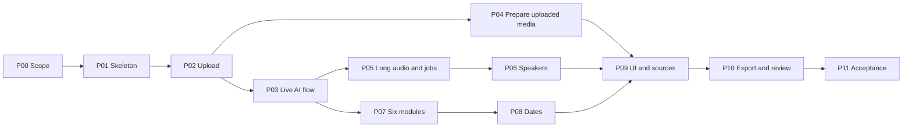

# SE2026-T15 — Breakdown & Implementation Phases

- **Dự án:** Meeting Minutes Assistant tiếng Việt (AI-05 — AI / Speech)
- **Repository:** https://github.com/vietquang8071/se2026-t15
- **Phiên bản:** 1.3 — 25/10/2026
- **Vị trí trong repo:** `docs/implementation-roadmap.md`
- **Mục đích:** Chia đề tài thành các phase, task và phạm vi commit rõ ràng để nhóm dễ triển khai, review và theo dõi tiến độ.

---

## 1. Cách dùng breakdown

- Đây là **kế hoạch triển khai**; danh sách task không phải bằng chứng tính năng đã được triển khai. Tại lần rà soát 25/10/2026, repo đã có bộ khung Next.js/NestJS/Prisma và helper kiểm tra/tách MP4 audio; HTTP upload, ASR và retention tự động chưa được triển khai.
- Có **12 phase, 72 task gợi ý**. Phase thể hiện thứ tự phụ thuộc, **không mặc định một phase bằng một tuần**. Nhóm chốt deadline và năng lực trước khi gán lịch.
- Mỗi task hướng đến **một thay đổi có thể review và kiểm tra**, thường tương ứng một commit logic. Có thể gộp task nhỏ hoặc chia task lớn; không tạo commit chỉ để đủ số lượng.
- Mỗi phase có 2 nhóm việc, đầu vào và đầu ra cụ thể. Kiểm thử liên quan đi cùng chức năng; task test riêng dành cho kịch bản tích hợp hoặc lỗi phức tạp.
- `FE`, `BE`, `AI` là vai trò gợi ý, không phải phân công cố định. Thành viên chọn task theo năng lực và cân bằng khối lượng; không cần mỗi người đúng hai commit/phase.
- Chỉ đánh dấu hoàn thành khi đầu ra chạy được, đã kiểm tra và có commit/PR liên quan. Mock được dùng để phát triển song song, phải ghi rõ và thay bằng tích hợp thật trước nghiệm thu.
- Không tạo cả 72 Issues ngay. Mỗi lần chọn 3–6 task sẵn sàng thực hiện, ghi owner, điều kiện hoàn thành và phụ thuộc.

## 2. Phạm vi cần giữ theo đề tài

Nguồn đối chiếu: `docs/product-description.md` v1.1, `docs/feature-overview.md` v1.0 và `CONTRIBUTING.md`. Đây là breakdown để thực hiện các tài liệu đó; những thay đổi phạm vi cần nhóm thống nhất và cập nhật tài liệu gốc.

| Feature Card hiện có                            | Đầu ra cần có trong MVP                                                                                         | Phase chính   |
| ----------------------------------------------- | --------------------------------------------------------------------------------------------------------------- | ------------- |
| FC1 — Audio Ingestion                           | Tạo meeting với title, anchor date, participants; upload WAV/MP3/M4A/WebM/MP4; tách audio từ MP4; chia file lớn | P02, P04, P05 |
| FC2 — Transcription & Speaker Attribution       | OpenAI Whisper API; timestamp theo segment **và word**; nhãn người nói; ghép transcript các chunk về audio gốc  | P03, P05, P06 |
| FC3 — Business Extraction & Temporal Resolution | Đủ 6 module, JSON có validation, ngày tương đối dựa trên ngày họp, bằng chứng nguồn                             | P03, P07, P08 |
| FC4 — Meeting Document UI & Export              | Xem đủ 6 module; tìm transcript; click timestamp để nghe; export Markdown và copy summary                       | P09, P10      |

**Sáu module bắt buộc:** Meeting Summary, Action Items, Decision Log, Open Issues / Questions, Follow-up Items, Timeline / Event Extraction. Summary/actions ở P03 chỉ là bản tích hợp ban đầu; không thay thế bốn module còn lại.

**Cần chốt trước khi triển khai:**

- **ASR:** giữ OpenAI Whisper API (`whisper-1`) theo đề tài. Dùng `response_format="verbose_json"` và `timestamp_granularities=["segment", "word"]`; kiểm tra response thật, lưu cả hai mức timestamp. Whisper transcription và speaker diarization là hai bước riêng. Tham khảo [API transcription](https://developers.openai.com/api/reference/resources/audio/subresources/transcriptions/methods/create).
- **Vòng đời provider:** hướng dẫn OpenAI hiện ghi `whisper-1` deprecated, hỗ trợ timestamp cho tích hợp hiện có đến 26/02/2027. P00 phải kiểm tra quyền sử dụng thực tế và thời hạn dự án; nếu cần đổi provider, nhóm cập nhật yêu cầu trước, giữ hợp đồng timestamp và speaker. Chưa coi quyền truy cập API là đã xác minh. Nguồn: [Speech-to-text — Timestamps](https://developers.openai.com/api/docs/guides/speech-to-text#timestamps).
- **File lớn:** giới hạn hiện tại là 25 MB/request; kiểm tra dung lượng **file chunk sau encode**, không chỉ số phút. Giới hạn upload của ứng dụng cần cho phép file lớn hơn để đi qua chunking. Nguồn: [Speech-to-text — Longer inputs](https://developers.openai.com/api/docs/guides/speech-to-text#longer-inputs).
- **Speaker:** phải có bước suy luận nhãn người nói từ audio hoặc phương án attribution được nhóm chấp thuận. `unknown` và sửa nhãn là fallback; chỉ gán tay không chứng minh tính năng tự động đã hoàn thành. Không dùng nội dung LLM suy đoán làm danh tính người nói đã xác thực.
- **Export:** MVP đã chốt Markdown và copy summary; JSON là dữ liệu cấu trúc nội bộ. Download JSON/HTML/PDF và audit history đầy đủ là phần mở rộng; không chặn phần audio hiện tại.
- **Ngày tháng:** với `anchor_date=2026-10-05`, “thứ Sáu này” là **2026-10-09**; `2026-10-08` là thứ Năm. “Tuần sau” chỉ xác định tuần nếu chưa có ngày cụ thể: giữ khoảng ngày/`needs_review`, không tự tạo deadline thứ Hai. P00 đồng bộ các ví dụ sai trong tài liệu gốc.

**Phần bổ sung, cần phân biệt với yêu cầu gốc:** sửa transcript/biên bản và cảnh báo khi tạo lại là cải thiện hữu ích, đặt tại P10. Audit history đầy đủ, xử lý xung đột nhiều người sửa và phân quyền phức tạp là phần mở rộng, không chặn MVP khi nhóm chưa đưa vào yêu cầu.

**Ngoài MVP theo đề tài:** live streaming transcription, bot tham gia Zoom/Meet/Teams, đồng bộ Calendar/Jira/Trello và voiceprint training.

### 2.1. Phạm vi audio đã cập nhật

- **Nguồn vào chỉ là upload** WAV/MP3/M4A/WebM/MP4, tối đa 100 MB và 60 phút; không thu âm trực tiếp, không MediaRecorder/waveform recorder.
- Sơn phát triển upload/preprocessing/audio API độc lập; Việt Quang làm LLM; App nối audio_id với meeting và làm thông báo gần hạn. Chưa nối các thành phần ngay.
- Metadata meeting vẫn thuộc App: title và anchor_date bắt buộc (YYYY-MM-DD), participants là danh sách tên có thể bỏ trống. Quyết định upload độc lập không thay đổi contract metadata đã chốt trước đó.
- ASR tiếp tục dùng Whisper qua dịch vụ ngoài; không thêm model Whisper local hoặc yêu cầu GPU local. Provider diarization bên ngoài cần chốt riêng khi tới P06.
- Chọn retention_days **30 hoặc 60** khi upload; audio API sẽ trả expires_at UTC. Bản gốc và audio dẫn xuất cùng hạn, App quyết định thời điểm/cách thông báo. Chưa có storage scheduler/notification trong code hiện tại.
- Kế hoạch endpoint độc lập và ranh giới trách nhiệm: [Audio service API plan](audio-service-api.md). Tài liệu này giữ các phase App/LLM làm ngữ cảnh tích hợp sau; hiện ưu tiên P02/P04 thuộc audio.

## 3. Ghi chú triển khai tối thiểu

Luồng chính: **Meeting + audio → kiểm tra/chia audio → Whisper transcript → speaker attribution → LLM trích xuất + xử lý ngày → giao diện + export**.

- Stack hiện tại là TypeScript với Next.js, NestJS, Prisma/PostgreSQL. Phần audio được đóng API độc lập và test trước khi nối App/LLM; giữ lại scaffold, không đổi kiến trúc App trong task audio.
- Dùng database và lưu audio trên local volume cho bản dev. Chỉ tạo model, endpoint và thư mục khi có task sử dụng; chưa cần nhiều lớp abstraction để dự phòng.
- P03 xử lý nền có trạng thái để HTTP trả về sớm. P05 bổ sung độ bền khi restart/retry; chọn queue phù hợp service audio nếu cần, chưa bắt buộc dựng từ P01.
- Dữ liệu tối thiểu: meeting, participants, audio, job, transcript segments/words, speakers và sáu loại artifacts. Artifact tham chiếu segment trong cùng meeting; các field chi tiết bám schema tài liệu gốc.
- Thiếu owner/deadline/rationale thì để `null` hoặc đánh dấu cần xác nhận; không tự bịa. JSON hợp lệ chưa đồng nghĩa nội dung đúng.
- API key và audio riêng tư không đưa vào Git; fixture phải có quyền sử dụng. Bản deploy công khai cần bảo vệ quyền truy cập meeting/audio phù hợp.

## 4. Các phase và task gợi ý commit

### P00 — Chốt phạm vi và đầu ra

**Đầu vào:** hai tài liệu đề tài và CONTRIBUTING. **Nhóm A:** yêu cầu (01–03). **Nhóm B:** hợp đồng và kế hoạch (04–06).

| Task   | Vai trò | Phần việc / đầu ra                                                                                               | Commit gợi ý                                         |
| ------ | ------- | ---------------------------------------------------------------------------------------------------------------- | ---------------------------------------------------- |
| P00-01 | FE      | Viết user flow upload → transcript → biên bản → export; phác thảo màn hình                                       | `docs(requirements): define meeting user flows`      |
| P00-02 | BE      | Chốt yêu cầu bắt buộc, giới hạn file/thời lượng, định dạng export; xác nhận deadline và ưu tiên phần mở rộng     | `docs(requirements): define MVP acceptance criteria` |
| P00-03 | AI      | Kiểm tra khả năng dùng Whisper và diarization, ngân sách, tài nguyên; ghi quyết định provider và rủi ro vòng đời | `docs(ai): record speech provider constraints`       |
| P00-04 | BE      | Thống nhất stack, schema meeting/transcript/artifacts, API và trạng thái xử lý ban đầu                           | `docs(api): define meeting data contracts`           |
| P00-05 | AI      | Chọn audio có quyền sử dụng và gold transcript/artifacts; mô tả cách đo và dự kiến tiêu chí chất lượng           | `docs(test): define AI evaluation cases`             |
| P00-06 | FE      | Đồng bộ ví dụ ngày tháng, link tương đối, README và liên kết roadmap với tài liệu gốc                            | `docs: align project planning documents`             |

**Hoàn thành khi:** nhóm phân biệt được yêu cầu bắt buộc và mở rộng; chốt export/provider, sample kiểm thử và hợp đồng dữ liệu để bắt đầu code. Nếu provider bị chặn, ghi blocker và quyết định thay thế trước khi tích hợp.

### P01 — Khởi tạo ứng dụng

**Phụ thuộc:** P00. **Nhóm A:** ứng dụng (01–03). **Nhóm B:** nền tảng kiểm tra (04–06).

| Task   | Vai trò | Phần việc / đầu ra                                                                           | Commit gợi ý                                 |
| ------ | ------- | -------------------------------------------------------------------------------------------- | -------------------------------------------- |
| P01-01 | BE      | Tạo backend, `/health`, settings, `.env.example`, `.gitignore`                               | `feat(api): bootstrap backend application`   |
| P01-02 | FE      | Tạo frontend, route và layout cơ bản                                                         | `feat(web): initialize frontend application` |
| P01-03 | AI      | Tạo hàm chuyển response ASR về schema chung và fixture segment/word, chưa cần nhiều provider | `feat(asr): define transcript normalization` |
| P01-04 | BE      | Kết nối database, migration/schema ban đầu và cấu hình thư mục lưu audio                     | `feat(db): configure meeting persistence`    |
| P01-05 | FE      | API client và trạng thái loading/error dùng chung; gọi `/health` thật                        | `feat(web): connect backend health endpoint` |
| P01-06 | BE      | Thêm smoke test, CI lint/test/build tối thiểu và lệnh chạy local                             | `ci: add application smoke checks`           |

**Hoàn thành khi:** frontend gọi được backend; database khởi tạo được; người khác chạy local theo README. Không cần tạo sẵn các thư mục chưa dùng.

### P02 — Tạo meeting và upload audio

**Phụ thuộc:** P01. **Nhóm A:** metadata (01–03). **Nhóm B:** upload (04–06).

| Task   | Vai trò | Phần việc / đầu ra                                                                                                                        | Commit gợi ý                                          |
| ------ | ------- | ----------------------------------------------------------------------------------------------------------------------------------------- | ----------------------------------------------------- |
| P02-01 | BE      | API tạo/lấy meeting, title, anchor date và participants; validation                                                                       | `feat(meetings): add meeting metadata API`            |
| P02-02 | FE      | Form tạo meeting, validate và điều hướng tới trang chi tiết                                                                               | `feat(meetings): add meeting creation form`           |
| P02-03 | Audio   | FFprobe/FFmpeg đọc metadata, kiểm tra decode và MP4 source offset                                                                         | `feat(audio): inspect uploaded media metadata`        |
| P02-04 | Audio   | API upload độc lập WAV/MP3/M4A/WebM/MP4; audio_id, local storage, retention_days 30/60 và expires_at                                      | `feat(audio): implement independent media upload API` |
| P02-05 | FE      | Chọn/kéo thả file, hiển thị metadata và lỗi upload                                                                                        | `feat(audio): add meeting audio uploader`             |
| P02-06 | Audio   | Test audio API độc lập: upload → đọc metadata; file lỗi, MP4 không tiếng, ID và retention không hợp lệ. App test meeting khi tích hợp sau | `test(audio): cover independent media upload`         |

**Hoàn thành phần audio P02 khi:** audio API upload/đọc metadata độc lập chạy được cho cả năm định dạng; file hỏng bị từ chối, retention metadata lưu đúng và path an toàn. Helper hiện tại chưa đáp ứng toàn bộ checkpoint API. Meeting/form/reload thuộc App và kiểm tra sau khi tích hợp.

### P03 — Luồng AI đầu tiên chạy thật

**Phụ thuộc:** P02. **Nhóm A:** transcription (01–03). **Nhóm B:** biên bản ban đầu (04–06).

| Task   | Vai trò | Phần việc / đầu ra                                                                           | Commit gợi ý                                          |
| ------ | ------- | -------------------------------------------------------------------------------------------- | ----------------------------------------------------- |
| P03-01 | BE      | API bắt đầu xử lý nền, lấy job status, lưu trạng thái và lỗi; chặn chạy trùng đang active    | `feat(jobs): add background processing status`        |
| P03-02 | AI      | Tích hợp Whisper cho audio ngắn; lấy segment/word timestamps, timeout và mã lỗi provider     | `feat(asr): transcribe audio with word timestamps`    |
| P03-03 | BE      | Lưu và trả transcript segments/words, kiểm tra timestamp trong duration                      | `feat(transcript): persist timestamped transcription` |
| P03-04 | AI      | LLM tạo Summary và Action Items tối giản; validate JSON, giữ source segment và field chưa rõ | `feat(extraction): add initial summary and actions`   |
| P03-05 | FE      | Hiển thị job status, transcript và summary/actions đơn giản; xử lý empty/error               | `feat(web): display initial meeting results`          |
| P03-06 | BE      | Nối pipeline thật, lưu artifacts và kiểm tra upload → ASR → LLM → reload kết quả             | `test(pipeline): verify initial live meeting flow`    |

**Hoàn thành khi — M1:** một audio ngắn đi qua **provider ASR và LLM thật**, xem được transcript cùng summary/actions. Lưu model/config, lỗi và kết quả kiểm tra; không dùng mock để kết luận tích hợp thật thành công. Speaker tự động và biên bản đủ sáu module hoàn thiện ở phase sau.

### P04 — Tách/chuẩn hóa audio upload và metadata vòng đời

**Phụ thuộc:** P02; có thể làm song song P03. **Nhóm A:** MP4/audio chuẩn hóa (01–03). **Nhóm B:** vòng đời/playback (04–06).

| Task   | Vai trò | Phần việc / đầu ra                                                                                 | Commit gợi ý                                      |
| ------ | ------- | -------------------------------------------------------------------------------------------------- | ------------------------------------------------- |
| P04-01 | Audio   | Nhận MP4 có một audio track, tách WAV riêng và giữ video gốc                                       | `feat(audio): extract audio from uploaded MP4`    |
| P04-02 | Audio   | Chuẩn hóa sample rate/channels/codec, trả metadata bản nguồn và bản xử lý                          | `feat(audio): normalize uploaded audio`           |
| P04-03 | Audio   | Giữ audio start offset và chunk offset cho timestamp về nguồn gốc                                  | `feat(audio): preserve source timeline offsets`   |
| P04-04 | Audio   | API phục vụ audio theo audio_id để App nối playback ở giai đoạn tích hợp                           | `feat(audio): expose processed audio playback`    |
| P04-05 | Audio   | Metadata retention_days 30/60 và expires_at; cleanup media hết hạn. App chịu trách nhiệm thông báo | `feat(storage): track audio retention and expiry` |
| P04-06 | Audio   | Test MP4 có/không có tiếng, lỗi xử lý, file tạm, expiry; không kiểm thử thu âm trình duyệt         | `test(audio): cover uploaded media processing`    |

**Hoàn thành khi:** file upload được chuẩn hóa/tách audio riêng, không đổi nguồn gốc; offset/metadata đúng, expiry 30/60 ngày có thể kiểm tra. Không coi helper đã có là toàn bộ API/cleanup đã hoàn thành.

### P05 — File dài, chunking và job ổn định

**Phụ thuộc:** P03; kiểm tra playback sau P04. **Nhóm A:** audio dài (01–03). **Nhóm B:** lỗi/retry (04–06).

| Task   | Vai trò | Phần việc / đầu ra                                                                                    | Commit gợi ý                                         |
| ------ | ------- | ----------------------------------------------------------------------------------------------------- | ---------------------------------------------------- |
| P05-01 | AI      | Chia audio theo dung lượng sau encode, overlap cấu hình được; mỗi chunk trong giới hạn API            | `feat(asr): split oversized audio recordings`        |
| P05-02 | AI      | Ghép segment và word timestamps về audio gốc, loại trùng vùng overlap                                 | `feat(asr): stitch chunk transcripts and timestamps` |
| P05-03 | BE      | Gắn tiến độ từng chunk vào job; lưu kết quả an toàn, quy định partial result                          | `feat(jobs): track chunk processing progress`        |
| P05-04 | BE      | Retry/backoff có giới hạn, idempotency và trạng thái job khi worker restart; chọn queue riêng nếu cần | `feat(jobs): handle retries and interrupted workers` |
| P05-05 | FE      | Hiển thị tiến độ/lỗi, cho retry phù hợp và tránh bấm xử lý liên tục                                   | `feat(web): add processing recovery controls`        |
| P05-06 | AI      | Kiểm tra chunk boundary, trùng chữ, offset segment/word và seek sau khi ghép                          | `test(asr): verify long audio stitching`             |

**Hoàn thành khi:** file lớn hơn 25 MB của ứng dụng được chia và xử lý; mỗi request đáp ứng giới hạn provider; retry không tạo transcript trùng. Phân biệt lỗi quota/provider với lỗi hệ thống, không báo thành công khi thiếu chunk.

### P06 — Speaker attribution và sửa nhãn

**Phụ thuộc:** P03; dùng output P05 khi audio nhiều chunk. **Nhóm A:** suy luận nhãn (01–03). **Nhóm B:** hiển thị/sửa nhãn (04–06).

| Task   | Vai trò | Phần việc / đầu ra                                                                        | Commit gợi ý                                            |
| ------ | ------- | ----------------------------------------------------------------------------------------- | ------------------------------------------------------- |
| P06-01 | AI      | Tích hợp phương án speaker attribution đã chốt, ví dụ diarization dựa trên audio          | `feat(diarization): detect speaker turns`               |
| P06-02 | AI      | Align speaker turns với transcript; speaker ID nhất quán qua chunk, xử lý overlap/unknown | `feat(diarization): align transcript speaker labels`    |
| P06-03 | BE      | Lưu speaker và mapping participant; API validate speaker thuộc meeting                    | `feat(speakers): persist meeting speaker mapping`       |
| P06-04 | FE      | Hiển thị speaker trên transcript, màu và nhãn unknown nhất quán                           | `feat(transcript): display attributed speakers`         |
| P06-05 | FE      | Đổi tên/gán Speaker 1 sang participant, lưu qua API và reload                             | `feat(speakers): add speaker mapping editor`            |
| P06-06 | AI      | Kiểm tra audio 2–3 người, overlap và nhiều chunk; ghi lỗi gán nhãn trước/sau sửa thủ công | `test(diarization): evaluate speaker attribution cases` |

**Hoàn thành khi:** có output attribution tự động trên audio kiểm thử, có thể sửa nhãn; báo riêng lỗi tự động và kết quả sau sửa. Chưa đủ chất lượng thì ghi giới hạn/blocker, không đổi nhãn “fallback thủ công” thành tính năng tự động hoàn thành.

### P07 — Hoàn thiện trích xuất sáu module

**Phụ thuộc:** P03; chạy lại với speaker sau P06. **Nhóm A:** schema/nội dung (01–03). **Nhóm B:** validation/bằng chứng (04–06).

| Task   | Vai trò | Phần việc / đầu ra                                                                            | Commit gợi ý                                              |
| ------ | ------- | --------------------------------------------------------------------------------------------- | --------------------------------------------------------- |
| P07-01 | BE      | Hoàn thiện schema/persistence sáu module theo tài liệu gốc; API đọc artifacts                 | `feat(minutes): complete six module schemas`              |
| P07-02 | AI      | Hoàn thiện Summary/Action Items: context, topics, owner, deadline, priority và nguồn          | `feat(extraction): refine summary and action items`       |
| P07-03 | AI      | Decision Log/Open Issues: phân biệt đã chốt với đề xuất, giữ rationale và phần chưa rõ        | `feat(extraction): add decisions and open issues`         |
| P07-04 | AI      | Follow-up/Timeline: phân biệt theo dõi với task; giữ raw temporal expression và nguồn         | `feat(extraction): add followups and timeline events`     |
| P07-05 | BE      | Validate JSON/schema và evidence trong cùng meeting; retry/repair hữu hạn, không tự bịa field | `feat(minutes): validate extracted artifacts and sources` |
| P07-06 | AI      | Đối chiếu gold artifacts, trường hợp không có quyết định/owner/deadline và nội dung mâu thuẫn | `test(extraction): verify six module business outputs`    |

**Hoàn thành khi — M2:** API có đủ sáu module; module không có thông tin trả danh sách rỗng hợp lệ. Item thiếu bằng chứng phải được đánh dấu cần review, không coi là kết quả đã xác minh.

### P08 — Chuẩn hóa ngày và timeline

**Phụ thuộc:** P07. **Nhóm A:** quy tắc thời gian (01–03). **Nhóm B:** kiểm tra/tích hợp (04–06).

| Task   | Vai trò | Phần việc / đầu ra                                                                                     | Commit gợi ý                                               |
| ------ | ------- | ------------------------------------------------------------------------------------------------------ | ---------------------------------------------------------- |
| P08-01 | AI      | Quy tắc anchor date/timezone, thứ trong tuần, tuần sau và cuối tháng; phân biệt ngày với khoảng ngày   | `feat(temporal): define relative date resolution rules`    |
| P08-02 | AI      | Resolve ngày từ expression; lưu raw statement, ngày/khoảng ngày và needs_review khi mơ hồ              | `feat(temporal): resolve meeting relative dates`           |
| P08-03 | BE      | Lưu kết quả temporal theo schema đã thống nhất cho timeline, action deadline và follow-up              | `feat(timeline): persist resolved event dates`             |
| P08-04 | AI      | Test 05/10/2026 → thứ Sáu 09/10/2026, cuối tháng, năm nhuận, qua năm và câu không đủ ngày              | `test(temporal): cover calendar boundaries and ambiguity`  |
| P08-05 | FE      | Timeline theo thứ tự ngày; tách rõ event chưa rõ ngày, không xếp thành ngày giả                        | `feat(timeline): display resolved meeting milestones`      |
| P08-06 | BE      | Kiểm tra thay anchor date phải yêu cầu tính lại/kết quả cũ được đánh dấu; đồng bộ ngày giữa các module | `test(timeline): verify date consistency across artifacts` |

**Hoàn thành khi:** ngày rõ ràng được tính đúng từ ngày họp; không dùng ngày chạy máy thay anchor date. Mốc mơ hồ giữ nguyên thông tin để người dùng xác nhận.

### P09 — Giao diện biên bản và truy nguồn

**Phụ thuộc:** P04, P06, P07, P08; UI có thể dựng trước bằng fixture. **Nhóm A:** sáu block (01–03). **Nhóm B:** tra cứu nguồn (04–06).

| Task   | Vai trò | Phần việc / đầu ra                                                                     | Commit gợi ý                                           |
| ------ | ------- | -------------------------------------------------------------------------------------- | ------------------------------------------------------ |
| P09-01 | FE      | Meeting summary và Action Items: task, checkbox/trạng thái, owner, deadline            | `feat(minutes): render summary and action items`       |
| P09-02 | FE      | Decision Log, Open Issues và Follow-up cards; rationale, source, empty states          | `feat(minutes): render decisions issues and followups` |
| P09-03 | FE      | Gắn Timeline vào trang biên bản và thống nhất loading/error/needs_review cho sáu block | `feat(minutes): assemble complete meeting document`    |
| P09-04 | FE      | Transcript inspector có speaker, tìm kiếm/highlight và click segment để nghe           | `feat(transcript): add searchable audio transcript`    |
| P09-05 | FE      | Click evidence của artifact → seek audio gốc và highlight segment nguồn                | `feat(minutes): link artifacts to source audio`        |
| P09-06 | BE      | Kiểm tra response nguồn, ID sai/khác meeting và nội dung frontend đọc đúng schema      | `test(minutes): verify document source navigation`     |

**Hoàn thành khi — M3:** xem đủ sáu block trên dữ liệu thật; từ action/decision/issue/follow-up/event nghe lại đúng nguồn. Click-to-play không trỏ vào timestamp cục bộ của chunk.

### P10 — Export và review cơ bản

**Phụ thuộc:** P09. **Nhóm A:** export bắt buộc (01–03). **Nhóm B:** cải thiện review (04–06, phần bổ sung).

| Task   | Vai trò | Phần việc / đầu ra                                                                                          | Commit gợi ý                                          |
| ------ | ------- | ----------------------------------------------------------------------------------------------------------- | ----------------------------------------------------- |
| P10-01 | BE      | Sinh Markdown đủ sáu module; JSON/HTML/PDF download là mở rộng                                              | `feat(export): generate meeting document downloads`   |
| P10-02 | FE      | Download Markdown và copy quick summary; lỗi download/clipboard rõ ràng                                     | `feat(export): add download and summary copy actions` |
| P10-03 | BE      | Kiểm tra export tiếng Việt, ngày tháng, speaker/source, module rỗng và nội dung mới nhất                    | `test(export): verify meeting document content`       |
| P10-04 | BE      | API sửa text/speaker và artifacts cơ bản; giữ bản gốc, đánh dấu kết quả phụ thuộc cũ khi sửa transcript     | `feat(review): save corrected meeting content`        |
| P10-05 | FE      | Form edit/save/cancel, yêu cầu xác nhận trước khi regenerate nội dung đã sửa                                | `feat(review): add meeting correction controls`       |
| P10-06 | FE      | Kiểm tra sửa → reload → export; không ghi đè âm thầm, timestamp từ gốc không giả lập alignment sau sửa text | `test(review): verify corrected content persistence`  |

**Hoàn thành khi — M4:** Markdown/copy hoạt động và các định dạng đã chốt ở P00 có đủ; nếu triển khai review thì export đúng phiên bản đã lưu. Audit history và chỉnh sửa đồng thời chỉ thêm sau khi nhóm nhận task riêng; không cần dựng trước.

### P11 — Kiểm thử tổng thể và bàn giao

**Phụ thuộc:** P03–P10; review bổ sung được ghi rõ nếu chưa làm. **Nhóm A:** chất lượng (01–03). **Nhóm B:** tái lập/demo (04–06).

| Task   | Vai trò | Phần việc / đầu ra                                                                                                    | Commit gợi ý                                          |
| ------ | ------- | --------------------------------------------------------------------------------------------------------------------- | ----------------------------------------------------- |
| P11-01 | AI      | Báo cáo WER/CER, lỗi speaker, kết quả trích xuất sáu module và temporal trên bộ kiểm thử đã chốt                      | `docs(ai): report meeting pipeline evaluation`        |
| P11-02 | BE      | Test file hỏng, ID sai, provider timeout/quota, JSON lỗi, retry và dọn file tạm                                       | `test(api): cover processing failure scenarios`       |
| P11-03 | FE      | E2E tự động dùng mock ổn định cho UI; ghi rõ phần mock trong kết quả                                                  | `test(e2e): cover meeting UI workflow`                |
| P11-04 | BE      | Tài liệu/lệnh setup từ môi trường sạch, biến môi trường, database/worker; Compose nếu stack cần                       | `chore(dev): finalize reproducible local setup`       |
| P11-05 | AI      | Chạy E2E provider thật cho audio upload và MP4: ASR → speaker → sáu module → source playback → export; lưu bằng chứng | `docs(test): record live pipeline acceptance results` |
| P11-06 | FE      | README, ảnh/video, demo script, giới hạn và release checklist; tổng hợp commit/PR liên quan                           | `docs: prepare meeting assistant handoff`             |

**Hoàn thành khi — M5:** người khác setup và chạy lại được; có bằng chứng provider thật và đủ tính năng bắt buộc. Test mock xanh không thay thế nghiệm thu thật. Chỉ tạo release sau review nhóm; roadmap không xác nhận dự án đã hoàn thành.

## 5. Thứ tự triển khai và chia PR



- P04 có thể song song P03; P06 có thể thử trên audio ngắn từ P03, rồi kiểm tra nhiều chunk sau P05; P07 có thể dùng transcript chuẩn trước khi diarization xong.
- FE dùng fixture theo contract trong lúc BE/AI đang làm. Đến checkpoint tích hợp phải thay fixture bằng API thật và kiểm tra lại.
- Mỗi PR nên gom task cùng đầu ra. Ví dụ `P02-01 + P02-02` cho tạo meeting; `P02-03 + P02-04 + P02-05 + P02-06` có thể chia thành PR upload backend và PR upload UI theo độ lớn thực tế.
- Không mở một PR quá lớn cho cả phase nếu nhiều phần độc lập; cũng không tách riêng code và test cần thiết chỉ để tăng commit.
- Khi deadline ngắn, ưu tiên hoàn thành yêu cầu gốc; dời review/audit mở rộng và hiệu ứng UI trước. Bản chỉ có upload, summary/actions hoặc gán speaker hoàn toàn thủ công là **demo từng phần**, chưa phải MVP đầy đủ. Không mặc định có bản 8 tuần đạt tất cả yêu cầu.

## 6. Issue → Branch → Commit → PR

Workflow thông thường theo `CONTRIBUTING.md`: tạo branch từ `develop`, PR về `develop`, reviewer khác approve và Squash and Merge; release dùng PR `develop → main`. Không push trực tiếp lên `main`/`develop`.

Ví dụ task P02-04, nếu chưa có Issue:

```bash
git switch develop
git pull --ff-only origin develop
git switch -c feature/audio-upload-api

# Hoàn thành upload và test liên quan
git add apps/api/src
git diff --cached
git commit -m "feat(audio): implement validated audio upload"
git push -u origin feature/audio-upload-api

# Mở PR vào develop, ghi task P02-04 và kết quả kiểm tra
```

Nếu có Issue thật, branch phải chứa số Issue theo quy định repo, ví dụ `feature/12-audio-upload-api` khi Issue #12 tồn tại. Không dùng số task P02-04 thay cho số Issue GitHub. Commit bằng tiếng Anh theo Conventional Commits.

**Mẫu Issue ngắn:**

```md
Task: Pxx-yy — [tên task]
Owner: [thành viên]
Depends on: [task/PR cần có trước]
Output: [API, màn hình hoặc artifact cụ thể]
Acceptance: [cách kiểm tra và kết quả mong đợi]
Commit/PR: [link khi có]
```

**Trước khi merge:** kiểm tra đúng scope, test liên quan, docs/schema đồng bộ, không có secrets/audio riêng tư; reviewer khác approve và xử lý comment quan trọng. Không cần tạo Issue cho từng commit nếu một Issue bao trùm một đầu ra logic.

Squash merge có thể gộp nhiều commit thành một commit trên `develop`; lưu link PR và commit của task để theo dõi tiến độ, không đánh giá tiến độ chỉ bằng số commit trên nhánh đích.

## 7. Kiểm tra tối thiểu trước khi đánh dấu hoàn thành

| Phần            | Cách kiểm tra                                                                                 | Phase |
| --------------- | --------------------------------------------------------------------------------------------- | ----- |
| Metadata/upload | Thiếu ngày/title, đủ bốn định dạng, file rỗng/MIME sai, reload                                | P02   |
| ASR             | Segment và word timestamp có thứ tự, trong duration; lỗi provider rõ ràng                     | P03   |
| MP4/retention   | Tách audio riêng, offset video đúng, giữ bản gốc, metadata 30/60 ngày và cleanup              | P04   |
| Chunk/job       | Dung lượng chunk, overlap, offset segment/word, retry/restart, không lưu trùng                | P05   |
| Speaker         | 2–3 người, overlap, ID speaker qua chunk, unknown; tách kết quả tự động và sửa tay            | P06   |
| Extraction      | Đủ sáu schema; decision khác proposal; follow-up khác open issue; owner/deadline không bị bịa | P07   |
| Temporal        | Ngày đúng từ anchor, qua tháng/năm; câu mơ hồ không bị ép thành ngày                          | P08   |
| Nguồn           | Item tham chiếu đúng segment cùng meeting và seek đúng audio gốc                              | P09   |
| Export/review   | Đủ module, đúng tiếng Việt/ngày và dữ liệu mới nhất; sửa được lưu nếu có review               | P10   |
| Nghiệm thu      | UI E2E mock và E2E provider thật có kết quả tách biệt; chạy lại từ setup sạch                 | P11   |

Đánh giá AI dùng audio/transcript/artifacts có đáp án đối chiếu; ghi model/config, cách chuẩn hóa tiếng Việt, thời gian xử lý và số lần lỗi/retry. Báo WER/CER cho ASR; tỷ lệ gán speaker đúng trên đoạn gán nhãn; precision/recall item trích xuất và độ đúng owner/deadline/nguồn; độ đúng ngày trên case có ngày rõ. Chốt ngưỡng sau baseline với nhóm, giữ bộ nghiệm thu riêng với mẫu dùng chỉnh prompt; không lấy một audio demo làm kết luận chất lượng chung.

## 8. Theo dõi tiến độ và bước tiếp theo

| Milestone | Kết quả kiểm chứng                                           | Phase |
| --------- | ------------------------------------------------------------ | ----- |
| M1        | Audio ngắn → transcript + summary/actions bằng provider thật | P03   |
| M2        | Đủ sáu module trên API, có validation và nguồn               | P07   |
| M3        | Biên bản đủ sáu block, speaker, ngày và click-to-play        | P09   |
| M4        | Export đủ phạm vi; review cơ bản nếu nhóm nhận triển khai    | P10   |
| M5        | Setup lại được, kiểm thử tổng thể và demo có bằng chứng      | P11   |

Trước mỗi đợt làm việc: chọn phase/task sẵn sàng, gán owner và hạn dự kiến, tạo Issues cần thiết. Cuối đợt: ghi task đã xong, link commit/PR, kết quả kiểm tra và blocker; chọn đầu ra tiếp theo. Không đánh dấu task đã xong chỉ vì đã push file hoặc có scaffold.

**Việc tiếp theo của audio:** đóng API upload/storage theo audio_id và retention_days 30/60, sau đó job chuẩn hóa/tách MP4, chunking, Whisper external và diarization external. Giữ App/LLM tách biệt tới khi audio API có contract và tests đủ để tích hợp.
