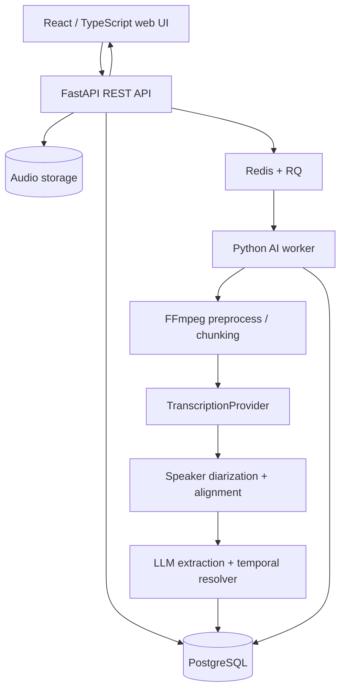
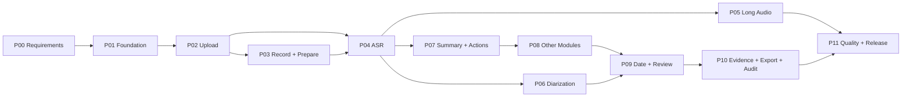

# SE2026-T15 — Repo Breakdown & Weekly Implementation Roadmap

> **Dự án:** Meeting Minutes Assistant tiếng Việt (AI-05 — AI / Speech)  
> **Repository:** https://github.com/vietquang8071/se2026-t15  
> **Phiên bản kế hoạch:** 1.0 — 24/10/2026  
> **Đường dẫn đề xuất khi đưa lên GitHub:** `docs/implementation-roadmap.md`  
> **Mục tiêu:** Chia toàn bộ MVP thành các phần đủ nhỏ để lập GitHub Issues, commit/push đều mỗi tuần, review qua PR và demo theo từng milestone.

---

## 0. Cách sử dụng tài liệu

- Đây là **backlog và thứ tự triển khai đề xuất**, **chưa phải** Issues/PR đã tạo trên GitHub và chưa có thay đổi nào được push lên repo.
- Kế hoạch mặc định **12 tuần, 3 thành viên**, mục tiêu **khoảng 6 commit có ý nghĩa/tuần trên toàn nhóm** (mỗi thành viên khoảng 2 commit/tuần), thường gom thành **3 PR/tuần**. Đây là nhịp gợi ý, **không phải quota**; không tạo commit rỗng hoặc chia một thay đổi thành các phần không chạy được chỉ để tăng số lượng.
- Mỗi dòng `Wxx-yy` dưới đây là **đơn vị công việc nhỏ, có thể tạo 1 commit logic**. Khi cần, một task có thể gồm nhiều commit; khi thay đổi quá nhỏ, ghép cùng test và code liên quan thành một commit.
- Dùng ô `[ ]` để theo dõi tiến độ. Chỉ đánh dấu `[x]` khi đã hoàn thành tiêu chí nghiệm thu, chạy test liên quan và liên kết được tới PR.
- **Đừng cố giữ đúng lịch tuần nếu phụ thuộc chưa xong.** Ưu tiên milestone chạy được hơn số lượng tính năng dở dang.
- `FE` = frontend; `BE` = backend/data; `AI` = audio/ASR/diarization/LLM. Phân công là **vai trò**, nhóm tự thay bằng tên thật.
- **P0:** bắt buộc cho demo end-to-end; **P1:** mục tiêu MVP đầy đủ theo tài liệu nhóm; **P2:** nâng cao/để sau. Có thể điều chỉnh ưu tiên khi được giảng viên thống nhất.

### Tài liệu đã có trong repo (kiểm tra ngày 24/10/2026)

| Đường dẫn | Tình trạng | Việc cần làm |
|---|---|---|
| `README.md` | Mới có tiêu đề | Bổ sung giới thiệu, setup, commands, screenshots |
| `CONTRIBUTING.md` | Đã có Git Flow rút gọn, commit/PR/review rules | Giữ nguyên workflow; áp dụng cho các PR |
| `docs/product-description.md` | Mô tả MVP và **6 module nghiệp vụ** | Chốt các điểm mơ hồ, đồng bộ tiêu chí và ví dụ ngày tháng |
| `docs/feature-overview.md` | Chia thành **4 Feature Cards** | Bổ sung manual editing, audit history, API/data contracts, testing |
| `frontend/`, `backend/` | Chưa có tại thời điểm kiểm tra | Tạo theo các tuần phía dưới |

Các nhánh hiện có: `main` và `develop` (đều được báo là protected). Repo hiện chưa có backlog GitHub Issues được tìm thấy. **Đọc `CONTRIBUTING.md` là nguồn quy định Git/PR cuối cùng** nếu kế hoạch này có điểm diễn đạt khác.

---

## 1. Phạm vi chức năng và thứ tự ưu tiên

### 1.1. MVP mục tiêu

| ID | Nhóm tính năng | Điều kiện thành công | Mức |
|---|---|---|---|
| FR-01 | Tạo meeting & metadata | Title, ngày họp (`anchor_date`), người tham gia | P0 |
| FR-02 | Upload file | WAV, MP3, M4A, WebM; kiểm tra file hợp lệ và lỗi | P0 |
| FR-03 | Record trong trình duyệt | Xin quyền microphone, Start/Pause/Resume/Stop, upload bản ghi | P1 |
| FR-04 | Audio preprocessing | Đọc duration, chuẩn hóa, chia chunk khi cần | P0 |
| FR-05 | Speech-to-Text | Transcript tiếng Việt + timestamp theo segment | P0 |
| FR-06 | Speaker diarization | Speaker 1/2/... hoặc unknown; gán/đổi tên được | P0 (thủ công fallback), P1 (tự động) |
| FR-07 | Meeting summary | Tóm tắt nội dung và chủ đề chính | P0 |
| FR-08 | Action items | Công việc, người phụ trách, deadline nếu có | P0 |
| FR-09 | Decision log | Quyết định đã chốt và bằng chứng | P1 |
| FR-10 | Open issues | Vấn đề chưa giải quyết | P1 |
| FR-11 | Follow-up items | Việc cần theo dõi sau họp | P1 |
| FR-12 | Project timeline | Mốc công việc/ngày tương đối được chuẩn hóa | P1 |
| FR-13 | Transcript/manual review | Sửa text, speaker và lưu lại thay đổi | P0 |
| FR-14 | Meeting minutes review | Sửa nội dung AI tạo, không bị ghi đè âm thầm | P0 |
| FR-15 | Audio seek theo nguồn | Nhấn timestamp để nghe lại đoạn gốc | P1 |
| FR-16 | Export | Markdown/JSON; có thể copy quick summary | P0 |
| FR-17 | Processing jobs | Trạng thái, lỗi, retry, chống chạy trùng | P0 |
| FR-18 | Edit audit | Lưu lịch sử sửa và thời gian sửa | P1 — quan trọng cho test SE |

**Để sau MVP:** live streaming ASR, bot Zoom/Meet, tích hợp Google Calendar/Jira/Trello, nhận diện danh tính bằng voiceprint, hệ thống quyền phức tạp, đa tenant, PDF nâng cao nếu chưa đủ nguồn lực.

### 1.2. Sáu module nghiệp vụ theo tài liệu hiện có

1. **Meeting Summary:** overview, key topics, context.
2. **Action Items:** task, owner, deadline, evidence timestamp.
3. **Decision Log:** decision, rationale, evidence.
4. **Open Issues:** câu hỏi/blocker chưa có kết luận.
5. **Follow-up Items:** nội dung cần kiểm tra, cuộc hẹn/theo dõi tiếp.
6. **Project Timeline:** sự kiện/mốc dự án được suy ra từ *ngày họp*, khác với timestamp trong audio.

**Nguyên tắc chất lượng:** Không bịa người thực hiện, ngày hết hạn hoặc quyết định. Thiếu thông tin thì để `null`/`unknown` hoặc `needs_review`. Mỗi artifact quan trọng phải tham chiếu đến nguồn: `source_segment_ids` hoặc timestamp.

---

## 2. Kiến trúc, stack và cấu trúc repo đích

### 2.1. Kiến trúc đề xuất



- **Frontend:** React + TypeScript + Vite; Tailwind CSS nếu nhóm chọn.
- **Backend:** Python + FastAPI + Pydantic + SQLAlchemy + Alembic.
- **Data & jobs:** PostgreSQL; Redis + RQ; audio trong local volume khi dev, có lớp storage abstraction để nâng cấp sau.
- **AI:** FFmpeg, `TranscriptionProvider` (có thể là faster-whisper hoặc cloud ASR), pyannote.audio nếu đủ tài nguyên, LLM trả dữ liệu theo schema.
- **Tests:** pytest, Vitest, Playwright; GitHub Actions cho lint/test/build.
- **Tính di động:** Model/provider có thể thay đổi. **Không khóa core business logic vào một tên model/API cố định.** Chốt model cụ thể bằng một ADR sau thử nghiệm chi phí, latency, timestamps, tiếng Việt và tài nguyên máy.
- **Bảo mật:** Không đưa `.env`, API key, audio thật hoặc thông tin người họp vào Git. Test fixture chỉ dùng audio có quyền sử dụng.

### 2.2. Cấu trúc thư mục đích

```text
se2026-t15/
├── README.md
├── CONTRIBUTING.md
├── .gitignore
├── .env.example
├── docker-compose.yml
├── docs/
│   ├── product-description.md            # đã có
│   ├── feature-overview.md                # đã có
│   ├── implementation-roadmap.md          # tài liệu này
│   ├── requirements.md
│   ├── architecture.md
│   ├── api-contract.md
│   ├── testing-plan.md
│   ├── benchmark-report.md                # cuối dự án
│   ├── release-checklist.md
│   └── decisions/                         # ADR: ASR, storage, diarization
├── frontend/
│   ├── package.json
│   ├── vite.config.ts
│   └── src/
│       ├── api/                           # typed API client
│       ├── components/                    # reusable UI
│       ├── features/
│       │   ├── meetings/
│       │   ├── audio/
│       │   ├── transcript/
│       │   └── minutes/
│       ├── pages/
│       ├── hooks/
│       └── types/
├── backend/
│   ├── pyproject.toml
│   ├── alembic/
│   ├── app/
│   │   ├── main.py
│   │   ├── api/routes/
│   │   ├── core/
│   │   ├── db/
│   │   ├── models/
│   │   ├── schemas/
│   │   ├── jobs/
│   │   └── services/
│   │       ├── audio/
│   │       ├── transcription/
│   │       ├── diarization/
│   │       ├── extraction/
│   │       ├── temporal/
│   │       └── export/
│   └── tests/
├── tests/
│   └── fixtures/                          # audio nhỏ + gold transcripts được phép sử dụng
└── .github/
    ├── workflows/
    ├── ISSUE_TEMPLATE/
    └── pull_request_template.md
```

### 2.3. Data model tối thiểu

| Entity | Trường chính | Ghi chú |
|---|---|---|
| `Meeting` | `id`, `title`, `anchor_date`, `status`, `created_at` | metadata & trạng thái tổng |
| `Participant` | `id`, `meeting_id`, `display_name` | tên do người dùng cung cấp |
| `AudioAsset` | `id`, `meeting_id`, `storage_key`, `mime_type`, `duration_sec`, `size_bytes` | không lưu binary vào DB |
| `ProcessingJob` | `id`, `meeting_id`, `stage`, `status`, `attempt_count`, `error_code` | trạng thái/retry/idempotency |
| `Speaker` | `id`, `meeting_id`, `label`, `participant_id` | mapping thủ công, có `unknown` |
| `TranscriptSegment` | `id`, `meeting_id`, `start_sec`, `end_sec`, `speaker_id`, `text`, `version` | nguồn tham chiếu |
| `MeetingArtifact` | `id`, `meeting_id`, `type`, `payload_json`, `review_status` | 6 loại artifact; chuẩn hóa dần nếu cần |
| `ArtifactEvidence` | `artifact_id`, `segment_id` | liên kết bằng chứng |
| `AuditEvent` | `id`, `meeting_id`, `entity_type`, `entity_id`, `before`, `after`, `changed_at` | lịch sử sửa; người sửa nếu có auth |

Không xây auth phức tạp ngay từ đầu. Với MVP chạy cục bộ, phải ghi rõ giới hạn truy cập; khi deploy công khai phải có cơ chế bảo vệ meeting/audio phù hợp, không công khai link file tùy ý.

### 2.4. API contract khởi đầu

| Method | Route | Response/chức năng |
|---|---|---|
| `GET` | `/health` | tình trạng backend |
| `POST` | `/api/meetings` | tạo meeting |
| `GET` | `/api/meetings/{id}` | metadata meeting |
| `POST` | `/api/meetings/{id}/audio` | upload audio |
| `GET` | `/api/meetings/{id}/audio` | phát audio có kiểm soát truy cập |
| `POST` | `/api/meetings/{id}/process` | `202 Accepted` + `job_id` |
| `GET` | `/api/jobs/{id}` | stage/status/progress/error |
| `GET` | `/api/meetings/{id}/transcript` | danh sách segment |
| `PATCH` | `/api/meetings/{id}/segments/{segment_id}` | cập nhật segment |
| `PATCH` | `/api/meetings/{id}/speakers/{speaker_id}` | cập nhật tên/gán speaker |
| `GET` | `/api/meetings/{id}/minutes` | dữ liệu 6 module |
| `PATCH` | `/api/meetings/{id}/minutes` | cập nhật biên bản |
| `GET` | `/api/meetings/{id}/audit` | lịch sử chỉnh sửa |
| `GET` | `/api/meetings/{id}/export?format=md` | xuất Markdown/JSON |

**Job state thống nhất:** `queued → preprocessing → transcribing → diarizing → extracting → ready`, thêm `failed`, `partial`, `reviewed` khi phù hợp. Không chặn HTTP request trong lúc model chạy.

---

## 3. Lộ trình 12 tuần — 12 phase lớn, 24 mini-phase, 72 commit gợi ý

**Ký hiệu:** mỗi `[ ]` = 1 task độc lập, thông thường ứng với 1 commit logic. Các commit message bên dưới là **gợi ý**, điều chỉnh cho đúng phạm vi code thực tế.

### Tuần 01 — P00: Chốt yêu cầu và thiết kế (6 commits; 3 PR)

**P00.1 — Requirements & product boundaries**

- [ ] **W01-01 [FE]** Viết user journeys/use cases cho upload → review → export tại `docs/requirements.md`. Commit: `docs(requirements): document meeting user journeys`.
- [ ] **W01-02 [BE]** Chốt FR/NFR, in-scope/out-of-scope, acceptance criteria và danh sách lỗi bắt buộc. Commit: `docs(requirements): define functional acceptance criteria`.
- [ ] **W01-03 [AI]** Chốt tiêu chí chọn ASR, diarization, benchmark audio và ghi ADR đầu tiên. Commit: `docs(ai): record transcription provider decision criteria`.

**P00.2 — System contracts & planning**

- [ ] **W01-04 [BE]** Phác thảo data model và bản API contract v1. Commit: `docs(api): define initial endpoints and data model`.
- [ ] **W01-05 [AI]** Viết `docs/testing-plan.md`, kịch bản WER/CER, noisy audio, failure/retry. Commit: `docs(test): define audio evaluation strategy`.
- [ ] **W01-06 [FE]** Bổ sung roadmap, sửa README, link tương đối trong docs, rà soát ví dụ ngày tháng sai. Commit: `docs: align project overview and roadmap`.

**PR đề xuất:** `docs/requirements-spec` • `docs/architecture-contract` • `docs/ai-test-plan`.

**Checkpoint:** 3 thành viên hiểu rõ MVP; ít nhất 1 luồng use case và hợp đồng API được review. **Không bắt đầu backend/AI dựa trên các field tự đoán.**

### Tuần 02 — P01: Khởi tạo monorepo và dev environment (6 commits; 3 PR)

**P01.1 — App skeleton**

- [ ] **W02-01 [BE]** Tạo FastAPI, `GET /health`, settings bằng biến môi trường, `.env.example`. Commit: `feat(api): bootstrap FastAPI application`.
- [ ] **W02-02 [FE]** Tạo React/Vite/TypeScript và route shell. Commit: `feat(web): initialize frontend application`.
- [ ] **W02-03 [AI]** Tạo package `services/transcription` và abstract interface/provider stub để dễ mock. Commit: `feat(asr): define transcription provider contract`.

**P01.2 — Shared development tools**

- [ ] **W02-04 [BE]** Thiết lập SQLAlchemy/Alembic, kết nối PostgreSQL, migration cơ bản. Commit: `feat(db): configure database and migrations`.
- [ ] **W02-05 [FE]** Tạo API client, error/loading component, trang landing placeholder. Commit: `feat(web): add API client and page shell`.
- [ ] **W02-06 [AI]** Thiết lập pytest fixtures/mocks cho AI service, smoke tests, GitHub Actions lint/test tối thiểu (phối hợp BE). Commit: `ci: add backend smoke tests and checks`.

**PR đề xuất:** `feature/backend-foundation` • `feature/frontend-foundation` • `feature/ai-foundation`.

**Checkpoint:** chạy frontend và backend local; `/health` trả OK; migration tạo được database; CI cơ bản chạy qua. Docker Compose có thể bổ sung vào PR backend nếu không vượt scope.

### Tuần 03 — P02: Meeting CRUD và file upload (6 commits; 3 PR)

**P02.1 — Meeting metadata & storage**

- [ ] **W03-01 [BE]** Model/schema và endpoint tạo/lấy meeting; unit test validation. Commit: `feat(meetings): add meeting create and detail API`.
- [ ] **W03-02 [FE]** Meeting form: title, anchor date, participants, validation. Commit: `feat(meetings): add meeting creation form`.
- [ ] **W03-03 [AI]** Audio inspection/metadata utility (`ffprobe`/FFmpeg) trả duration, codecs, sample rate. Commit: `feat(audio): inspect uploaded audio metadata`.

**P02.2 — Audio ingest**

- [ ] **W03-04 [BE]** API upload multipart + định dạng/dung lượng + storage path an toàn; tests file hợp lệ/file rỗng/file lỗi. Commit: `feat(audio): implement validated audio upload`.
- [ ] **W03-05 [FE]** File picker + drag/drop + lỗi upload + dung lượng/duration hiển thị. Commit: `feat(audio): build upload component`.
- [ ] **W03-06 [AI]** Chuẩn bị audio fixtures có quyền sử dụng, mẫu WAV/MP3/WebM và audio lỗi (không chứa dữ liệu cá nhân). Commit: `test(audio): add ingestion test fixtures`.

**PR đề xuất:** `feature/meeting-crud` • `feature/audio-upload-api` • `feature/audio-upload-ui`.

**Checkpoint:** tạo meeting rồi upload file thành công; reload vẫn xem được metadata và file gốc.

### Tuần 04 — P03: Browser recorder, audio preview, preprocessing (6 commits; 3 PR)

**P03.1 — In-browser recording**

- [ ] **W04-01 [FE]** `getUserMedia()` + `MediaRecorder` start/stop, xin quyền microphone và kiểm tra MIME hỗ trợ. Commit: `feat(recording): capture microphone audio in browser`.
- [ ] **W04-02 [FE]** Pause/resume, timer, audio preview, nút upload recording. Commit: `feat(recording): add controls and recording preview`.
- [ ] **W04-03 [BE]** Endpoint stream/serve audio cho meeting, trả lỗi file không tồn tại, test header/content type. Commit: `feat(audio): expose meeting audio playback endpoint`.

**P03.2 — Audio normalization**

- [ ] **W04-04 [AI]** FFmpeg normalize input thành định dạng do ASR provider yêu cầu; test thời lượng giữ hợp lý. Commit: `feat(audio): normalize recordings for transcription`.
- [ ] **W04-05 [AI]** Thêm test codec/định dạng và phản hồi lỗi `ffmpeg` rõ ràng. Commit: `test(audio): cover media conversion failures`.
- [ ] **W04-06 [BE]** Quản lý storage key, chống path traversal, xoá file tạm sau xử lý/lỗi; tests. Commit: `fix(storage): harden audio file lifecycle`.

**PR đề xuất:** `feature/browser-recording` • `feature/audio-playback` • `feature/audio-preprocessing`.

**Checkpoint:** người dùng thu → stop → nghe lại → upload; audio MP3/M4A/WAV/WebM được chuẩn hóa hoặc trả lỗi rõ ràng.

### Tuần 05 — P04: Job queue + ASR baseline (6 commits; 3 PR)

**P04.1 — Async jobs & model integration**

- [ ] **W05-01 [BE]** `ProcessingJob` model, `POST /process`, `GET /jobs/{id}`, trạng thái chuẩn. Commit: `feat(jobs): add meeting processing job API`.
- [ ] **W05-02 [BE]** Redis/RQ worker, job enqueue, worker startup và Docker Compose dependencies. Commit: `feat(jobs): run transcription in background worker`.
- [ ] **W05-03 [AI]** Tích hợp provider ASR được chốt trong ADR, trả transcript segments với timestamps. Commit: `feat(asr): implement baseline speech transcription`.

**P04.2 — Store & display transcript**

- [ ] **W05-04 [AI]** Chuẩn hóa output ASR: `start_sec`, `end_sec`, `text`, text encoding, lỗi model; tests adapter. Commit: `feat(asr): normalize transcript segments`.
- [ ] **W05-05 [FE]** Job status screen (queued/processing/ready/failed) và polling có cleanup. Commit: `feat(web): display transcription progress`.
- [ ] **W05-06 [FE]** Transcript inspector v1: list segment, timestamp, empty/error state. Commit: `feat(transcript): render timestamped segments`.

**PR đề xuất:** `feature/processing-jobs` • `feature/asr-transcription` • `feature/transcript-view`.

**Checkpoint / Milestone M1:** **Upload → Process → Transcript** chạy end-to-end trên audio tiếng Việt ngắn; worker lỗi không làm backend HTTP bị treo.

### Tuần 06 — P05: Audio dài, stitching và tra cứu transcript (6 commits; 3 PR)

**P05.1 — Long-audio resilience**

- [ ] **W06-01 [AI]** Chia chunk theo giới hạn provider với overlap được cấu hình. Commit: `feat(asr): split long recordings into chunks`.
- [ ] **W06-02 [AI]** Stitch transcript, chuyển offset về audio gốc, loại trùng vùng overlap; unit tests. Commit: `feat(asr): merge chunk transcripts and timestamps`.
- [ ] **W06-03 [BE]** Retry/backoff giới hạn, mã lỗi ổn định, tránh enqueue job trùng trên cùng request. Commit: `feat(jobs): add retry and idempotency guards`.

**P05.2 — Usability & integration tests**

- [ ] **W06-04 [BE]** Test integration file dài, worker timeout/restart, partial result policy. Commit: `test(jobs): cover long-audio failure cases`.
- [ ] **W06-05 [FE]** Search/filter từ khóa trong transcript, highlight kết quả. Commit: `feat(transcript): add transcript search`.
- [ ] **W06-06 [FE]** Gắn timestamps với audio player và phát từ giây được chọn. Commit: `feat(transcript): seek audio by segment timestamp`.

**PR đề xuất:** `feature/long-audio-processing` • `feature/job-resilience` • `feature/transcript-inspector`.

**Checkpoint:** file dài được chia/ghép đúng; `start_sec/end_sec` vẫn tương ứng vị trí trong audio gốc; có test kiểm tra overlap. Lưu mẫu benchmark baseline đầu tiên dù chưa có báo cáo cuối.

### Tuần 07 — P06: Speaker diarization và speaker mapping (6 commits; 3 PR)

**P06.1 — Speaker inference**

- [ ] **W07-01 [AI]** Tích hợp diarization adapter (ví dụ pyannote) và output các speaker turns. Commit: `feat(diarization): detect speaker turns`.
- [ ] **W07-02 [AI]** Align speaker turns với ASR segments; overlap/unknown fallback + unit tests. Commit: `feat(diarization): align speakers with transcript`.
- [ ] **W07-03 [BE]** Model/API `Speaker`, mapping với participant; lưu speaker ID trên segment. Commit: `feat(speakers): persist speaker labels and mapping`.

**P06.2 — Human correction**

- [ ] **W07-04 [BE]** PATCH speaker rename/mapping API, validate ID thuộc meeting. Commit: `feat(speakers): support speaker label corrections`.
- [ ] **W07-05 [FE]** Transcript badges theo speaker, trạng thái `unknown`, màu nhất quán. Commit: `feat(transcript): display speaker labels`.
- [ ] **W07-06 [FE]** UI đổi tên/gán Speaker 1 → tên participant và persist sau reload. Commit: `feat(speakers): add speaker mapping editor`.

**PR đề xuất:** `feature/speaker-diarization` • `feature/speaker-api` • `feature/speaker-ui`.

**Checkpoint:** file có 2–3 speaker cho ra nhãn, nhãn có thể sửa bằng tay; không tự coi speaker label là danh tính đã xác thực.

### Tuần 08 — P07: LLM Extraction I — Summary, Action Items (6 commits; 3 PR)

**P07.1 — Artifact contracts**

- [ ] **W08-01 [BE]** Pydantic schema cho 6 artifact types và `MeetingArtifact` persistence. Commit: `feat(minutes): define structured artifact schemas`.
- [ ] **W08-02 [BE]** API read/write generated artifacts + status/review metadata. Commit: `feat(minutes): expose generated minutes API`.
- [ ] **W08-03 [AI]** LLM adapter, prompt versioning, JSON schema validation, xử lý output thiếu field. Commit: `feat(extraction): create validated LLM extraction service`.

**P07.2 — Core business outputs**

- [ ] **W08-04 [AI]** Summary + Action Items prompts; mỗi item có `source_segment_ids` nếu tìm được bằng chứng. Commit: `feat(extraction): generate summary and action items`.
- [ ] **W08-05 [FE]** Trang meeting result với Summary, loading/empty/error states. Commit: `feat(minutes): display meeting summary`.
- [ ] **W08-06 [FE]** Bảng Action Items: task, owner, deadline, trạng thái cần xác minh. Commit: `feat(minutes): display action item table`.

**PR đề xuất:** `feature/minutes-data-contract` • `feature/summary-actions-extraction` • `feature/minutes-core-ui`.

**Checkpoint / Milestone M2:** **Audio → transcript → summary + action items** với output JSON hợp lệ. Thiếu người phụ trách/deadline thì `null`, không tự suy diễn.

### Tuần 09 — P08: LLM Extraction II — 4 module còn lại (6 commits; 3 PR)

**P08.1 — Business modules**

- [ ] **W09-01 [AI]** Decision Log và Open Issues prompts, phân biệt quyết định đã chốt với đề xuất. Commit: `feat(extraction): add decisions and open issues`.
- [ ] **W09-02 [AI]** Follow-up Items và Timeline events prompts, raw temporal expressions. Commit: `feat(extraction): add followups and timeline events`.
- [ ] **W09-03 [BE]** Artifact evidence relation (`artifact_id → segment_id`) và API trả source references. Commit: `feat(minutes): persist evidence segment references`.

**P08.2 — Present six modules**

- [ ] **W09-04 [BE]** Validate/reference-check artifact payload, từ chối segment ID ngoài meeting. Commit: `test(minutes): validate artifact evidence integrity`.
- [ ] **W09-05 [FE]** Decision/Open Issue/Follow-up cards, states khi không có kết quả. Commit: `feat(minutes): display decision and followup sections`.
- [ ] **W09-06 [FE]** Project Timeline component, hiển thị event không rõ ngày như `needs_review` thay vì tự chọn ngày. Commit: `feat(timeline): render project milestones`.

**PR đề xuất:** `feature/remaining-extraction` • `feature/artifact-evidence` • `feature/minutes-extra-ui`.

**Checkpoint:** cả 6 module đều có schema, UI và dữ liệu kiểm thử. Quyết định chỉ được ghi nhận khi có bằng chứng đã thống nhất.

### Tuần 10 — P09: Temporal resolution + manual review (6 commits; 3 PR)

**P09.1 — Time interpretation**

- [ ] **W10-01 [AI]** Resolve các cụm “thứ Sáu này”, “tuần sau”, “cuối tháng” dựa trên `anchor_date`; ngày mơ hồ → `null/needs_review`. Commit: `feat(temporal): resolve relative Vietnamese dates`.
- [ ] **W10-02 [AI]** Unit tests ngày cuối tháng, qua năm, timezone, câu mơ hồ + negative extraction tests. Commit: `test(temporal): cover date boundaries and ambiguity`.
- [ ] **W10-03 [BE]** PATCH transcript segment text/speaker, optimistic version check để tránh ghi đè. Commit: `feat(transcript): support manual segment edits`.

**P09.2 — Review generated content**

- [ ] **W10-04 [BE]** PATCH minutes artifact và `review_status`; xác định rule regeneration không ghi đè nội dung đã sửa. Commit: `feat(minutes): support reviewed artifact updates`.
- [ ] **W10-05 [FE]** Transcript inline editor, save/cancel, lỗi validation, trạng thái saved. Commit: `feat(transcript): add inline text editor`.
- [ ] **W10-06 [FE]** Editor cho action items, decisions, date/timeline; cảnh báo khi regenerate. Commit: `feat(minutes): add human review controls`.

**PR đề xuất:** `feature/temporal-resolution` • `feature/review-api` • `feature/review-ui`.

**Checkpoint / Milestone M3:** toàn bộ biên bản có thể sửa và lưu lại; date resolution có test; người dùng biết phần nào AI chưa chắc chắn.

### Tuần 11 — P10: Evidence, audit, export (6 commits; 3 PR)

**P10.1 — Traceability & audit**

- [ ] **W11-01 [BE]** Append-only `AuditEvent` khi sửa transcript/minutes; API đọc lịch sử thay đổi. Commit: `feat(audit): record manual edits and history`.
- [ ] **W11-02 [AI]** Validator để artifact trỏ đúng segment nguồn, kiểm thử khi transcript đã edit. Commit: `test(extraction): verify source evidence after edits`.
- [ ] **W11-03 [FE]** Click source timestamp trong từng artifact → seek audio + highlight source segment. Commit: `feat(minutes): jump from artifact to source audio`.

**P10.2 — Export & quality**

- [ ] **W11-04 [BE]** Export Markdown/structured JSON từ **phiên bản đã review**, unit tests định dạng. Commit: `feat(export): generate reviewed minutes as markdown and json`.
- [ ] **W11-05 [FE]** Download Markdown/JSON, copy quick summary, hiển thị lỗi export. Commit: `feat(export): add meeting export actions`.
- [ ] **W11-06 [AI]** Bộ test sample noisy audio và baseline WER/CER; lưu phép đo có thể tái lập. Commit: `test(asr): add noisy-audio benchmark baseline`.

**PR đề xuất:** `feature/audit-history` • `feature/source-navigation` • `feature/export`.

**Checkpoint / Milestone M4:** click evidence nghe được audio, sửa rồi export ra nội dung mới nhất, edit history kiểm tra được, có kết quả benchmark ban đầu.

### Tuần 12 — P11: Harden, release và demo (6 commits; 3 PR + release PR)

**P11.1 — Quality gates**

- [ ] **W12-01 [AI]** Báo cáo WER/CER, speaker diarization edge cases, hạn chế model trong `docs/benchmark-report.md`. Commit: `docs(ai): publish speech evaluation results`.
- [ ] **W12-02 [AI]** Negative tests: speaker overlap, LLM thiếu owner/deadline, retry timeout, bad structured JSON. Commit: `test(ai): cover ambiguous and failure scenarios`.
- [ ] **W12-03 [BE]** API tests về missing/invalid IDs, upload abuse, expired temp files, log không lộ secret; CI hoàn chỉnh. Commit: `test(api): harden validation and failure handling`.

**P11.2 — User acceptance & release**

- [ ] **W12-04 [BE]** Docker Compose one-command setup, health/readiness, database migrate instructions. Commit: `chore(dev): finalize reproducible local setup`.
- [ ] **W12-05 [FE]** Playwright happy path `create → upload → process(mock) → edit → export`, fix lỗi UX nghiêm trọng. Commit: `test(e2e): cover complete meeting workflow`.
- [ ] **W12-06 [FE]** README final, screenshot/test evidence, demo script, release checklist. Commit: `docs: prepare MVP demo and usage guide`.

**PR đề xuất:** `feature/release-test-suite` • `fix/release-stability` (chỉ nếu có lỗi thực tế) • `docs/release-documentation`. Cuối cùng mở PR **`develop → main`** và tag release, ví dụ `v0.1.0`, **sau khi** nhóm review & tests đạt.

**Checkpoint / Milestone M5:** một người mới clone repo, làm theo README và chạy được demo từ đầu đến cuối; các lỗi chặn demo được xử lý.

---

## 4. Bảng tổng hợp để theo dõi mỗi tuần

| Tuần | Phase | 3 ưu tiên phải hoàn thành | Số commit gợi ý | Kết quả demo |
|---|---|---|---:|---|
| 01 | P00 | SRS, API contract, ADR & test plan | 6 | Review tài liệu |
| 02 | P01 | App skeleton, DB, CI | 6 | Frontend gọi `/health` |
| 03 | P02 | Tạo meeting, upload, validate | 6 | Upload thành công |
| 04 | P03 | Browser recorder, FFmpeg, playback | 6 | Ghi âm rồi upload |
| 05 | P04 | Job queue, ASR, transcript UI | 6 | **M1: Audio → transcript** |
| 06 | P05 | Chunking, retry, transcript search | 6 | File dài xử lý đúng |
| 07 | P06 | Diarization, speaker mapping | 6 | 2–3 speakers có thể sửa nhãn |
| 08 | P07 | Summary, action items | 6 | **M2: AI minutes cơ bản** |
| 09 | P08 | 4 module còn lại, evidence | 6 | Xem đủ 6 module |
| 10 | P09 | Temporal tests, editor | 6 | **M3: Human review** |
| 11 | P10 | Evidence seek, export, audit | 6 | **M4: Biên bản kiểm chứng được** |
| 12 | P11 | Benchmarks, E2E, docs, release | 6 | **M5: Demo/release** |
| **Tổng** | **12 phase / 24 mini-phase** | **72 task gợi ý** | **~72** | **5 milestone** |

**Nhịp làm việc gợi ý trong một tuần:**

- **Thứ Hai:** chọn 3 Issues/PR scopes, kéo `develop` mới nhất, thống nhất API của tuần; mỗi người tạo branch riêng.
- **Thứ Ba–Tư:** mỗi người hoàn thành commit logic đầu tiên (code + test liên quan), push để backup và dễ review.
- **Thứ Năm:** mỗi người thêm commit thứ hai cho phần bổ sung/edge cases; mở PR vào `develop`.
- **Thứ Sáu–Cuối tuần:** review chéo, sửa theo feedback, chạy test, squash merge; ghi log tiến độ và screenshot demo cho giảng viên.
- Nếu có blocker, tạo issue/ghi chú blocker thay vì đưa code dở vào `develop`.

### Mẫu weekly progress log (copy vào Issue/Discussion)

```md
## Week XX — YYYY-MM-DD → YYYY-MM-DD
- Goal:
- Owner FE:
  - [ ] Task WXX-...
- Owner BE:
  - [ ] Task WXX-...
- Owner AI:
  - [ ] Task WXX-...
- Commits: [commit URL], [commit URL]
- PRs: [PR URL]
- Demo evidence: [screenshot/video/test output]
- Tests run:
- Blockers/risks:
- Next-week handoff:
```

---

## 5. Cách chia Issue → Branch → Commit → Push → PR

### 5.1. Tuân thủ quy tắc sẵn có ở `CONTRIBUTING.md`

- `main` là bản ổn định; `develop` là nhánh tích hợp.
- Không push trực tiếp lên `main` hay `develop`.
- Branch hợp lệ: `feature/*`, `fix/*`, `docs/*`, `refactor/*`, `hotfix/*`; **không tự tạo** `chore/*` nếu `CONTRIBUTING.md` không cho phép.
- Khi Issue đã được tạo, tên branch bắt buộc chứa **GitHub Issue số thật**: `feature/<issue-id>-audio-upload` (ví dụ `feature/12-audio-upload` **chỉ khi thực sự có Issue #12**).
- Nếu chưa có Issue, dùng `feature/audio-upload`, `docs/requirements-spec`, v.v.; không bịa số Issue.
- Commit theo Conventional Commits: `feat(audio): ...`, `fix(api): ...`, `docs: ...`, `test(asr): ...`, `ci: ...`.
- PR nhỏ, một mục tiêu; ít nhất **một thành viên khác** approve; tests xanh; feature/docs/fix PR vào `develop` và **Squash and Merge**.
- Release PR `develop → main` dùng merge commit theo `CONTRIBUTING.md`.

### 5.2. Minh họa một task có 2 commit hợp lý

Ví dụ Issue thật có số `#12` và liên quan audio upload:

```bash
git switch develop
git pull --ff-only origin develop
git switch -c feature/12-audio-upload

# Hoàn thành validation + tests
git add backend/app/api backend/tests
git commit -m "feat(audio): validate uploaded media files"
git push -u origin feature/12-audio-upload

# Hoàn thành lưu file + tests, tiếp tục trên branch đó
git add backend/app/services/audio backend/tests
git commit -m "feat(audio): store validated meeting recordings"
git push

# Mở PR: feature/12-audio-upload -> develop
```

Hai commit phải là hai bước tiến **có thể giải thích rõ thay đổi và kiểm thử**, không phải 2 commit chỉ để tăng số lượng. Không nhất thiết mỗi commit phải deploy được, nhưng **PR cuối cùng phải chạy và qua tests**.

### 5.3. Đừng nhầm số commit với lịch sử trên `develop`

Theo quy định repo, feature PR **Squash and Merge**: ví dụ 3 commit trên feature branch sau merge sẽ thành **một squash commit** trên `develop`. Giáo viên xem lịch sử PR/nhánh và các commit bên trong PR sẽ thấy các lần push/commit thực tế; trên log `develop` chỉ thấy commit squash. Nên lưu **link Issues, PRs và weekly log** để minh chứng, không cố thay đổi merge strategy trái quy định.

### 5.4. Mẫu PR description

```md
## Goal
Implement [scope], related to #[real-issue-number].

## Changes
- [ ] Change A
- [ ] Change B

## Test evidence
- [ ] Relevant unit tests passed
- [ ] Integration tests/manual check performed
- [ ] No secrets or private audio in Git

## Screenshot / Sample output
[link or description]

## Known limitations / Follow-up
[details]
```

### 5.5. Mẫu Definition of Done cho Issue/PR

- [ ] Có mục tiêu và acceptance criteria cụ thể.
- [ ] Chạy được luồng chức năng được thay đổi (hoặc có mock hợp lệ nếu dependency chưa xong).
- [ ] Tests liên quan chạy thành công, có dẫn chứng khi cần.
- [ ] API schema/data migrations đồng bộ với frontend và backend.
- [ ] Không lộ API key, token, private audio hoặc dữ liệu cá nhân.
- [ ] Docs/README cập nhật khi hành vi public thay đổi.
- [ ] Một reviewer khác approve và các comment quan trọng đã xử lý.
- [ ] PR được merge đúng branch và linked Issue chuyển sang Done.

---

## 6. Phụ thuộc giữa các nhóm việc



**Các việc có thể làm song song bằng mock:** UI meeting form có thể làm trước khi có DB; transcript UI dùng JSON fixture trước khi ASR hoàn chỉnh; minutes UI dùng fixture Pydantic JSON trước khi prompt LLM hoàn thiện. Mỗi mock phải có kế hoạch thay bằng API thật, không để mock lẫn vào production.

---

## 7. Bộ test tối thiểu nên giữ xuyên suốt

| Mã test | Kịch bản | Mốc nên có |
|---|---|---|
| T-01 | Tạo meeting thiếu `title` hoặc `anchor_date` | W03 |
| T-02 | Upload file hợp lệ, file rỗng, MIME giả, sai extension, quá giới hạn | W03–W04 |
| T-03 | Record: không được cấp quyền microphone, pause/resume, stop | W04 |
| T-04 | ASR trả segment timestamp có thứ tự và nằm trong duration | W05 |
| T-05 | Audio chunk overlap không trùng text/timestamp sau stitch | W06 |
| T-06 | Job timeout/retry không tạo 2 transcript/artifacts trùng | W06 |
| T-07 | 2–3 speakers, overlap, unknown, manual mapping | W07 |
| T-08 | LLM không bịa deadline/owner khi transcript không nêu | W08–W09 |
| T-09 | Decision khác proposal; open issue khác follow-up | W09 |
| T-10 | Date resolution: thứ Sáu này/tuần sau/cuối tháng, tháng 12 → tháng 1 | W10 |
| T-11 | Sửa transcript/minutes rồi reload không mất dữ liệu | W10 |
| T-12 | Source link seek đúng audio timestamp | W11 |
| T-13 | Audit lưu before/after và không ghi đè edit thủ công âm thầm | W11 |
| T-14 | Export đúng dữ liệu đã review; không xuất dữ liệu cũ | W11 |
| T-15 | WER/CER trên sample tiếng Việt rõ & nhiễu, có gold transcript | W11–W12 |
| T-16 | End-to-end: create → upload → process → review → export | W12 |

**Lưu ý test dữ liệu:** trước khi đo WER/CER, định nghĩa rõ cách chuẩn hóa tiếng Việt (viết hoa, dấu câu, số, tách từ). Benchmark có bảng tên fixture, duration, đặc tính nhiễu, model/config, tham số đo và kết quả; không tự đặt target độ chính xác khi chưa có baseline.

---

## 8. Rủi ro và phương án dự phòng

| Rủi ro | Ảnh hưởng | Phương án |
|---|---|---|
| ASR chạy chậm/thiếu GPU | Trễ demo | Test sớm W02/W05; provider adapter; dùng file demo ngắn; cân nhắc cloud API khi có ngân sách và consent |
| Diarization chưa đủ chính xác | Sai Speaker 1/2 | `unknown`, manual mapping, benchmark riêng |
| Transcript nhiều chunk bị trùng/lệch | Source timestamp sai | Overlap tests + offset & de-dup logic |
| LLM trả JSON lỗi/hallucination | Action item, deadline sai | Pydantic validation, retry hợp lý, evidence segment, human review |
| Dự án quá nhiều chức năng | PR lớn, trễ tiến độ | Giữ P0; dời P2; giảm UI hiệu ứng trước khi bỏ test |
| Thành viên chờ API của nhau | Chặn nhau | Chốt schema W01; FE mock API; contract tests |
| File audio/keys bị push lên GitHub | Rủi ro bảo mật | `.gitignore`, `.env.example`, secret review, mẫu audio được phép |
| Giảng viên cần lịch sử commit hàng tuần | Khó minh chứng sau squash | Weekly log kèm link commit/PR, tạo PR thường xuyên đúng workflow |

---

## 9. Danh sách ưu tiên nếu deadline ngắn hơn 12 tuần

### Bản 8 tuần (MVP gọn)

- **Tuần 1:** gộp P00 + P01 (requirements/skeleton tối thiểu).
- **Tuần 2:** P02 + cắt bớt P03 (upload ưu tiên, record để sau).
- **Tuần 3:** P04 (ASR ngắn, transcript timestamps).
- **Tuần 4:** P05 rút gọn + P06 fallback thủ công cho speaker.
- **Tuần 5:** P07 (summary/actions).
- **Tuần 6:** P08 + temporal cơ bản (hoặc giảm độ chi tiết các module phụ).
- **Tuần 7:** P09 + P10 (editor, export Markdown, audit cơ bản).
- **Tuần 8:** P11 (tests, docs, demo, release).

**Không được hy sinh:** API validation, bảo vệ dữ liệu ghi âm, khả năng sửa kết quả AI, ít nhất một E2E test, benchmark có nguồn và lịch sử PR đáng kiểm chứng.

### Definition of Release

- [ ] `develop` ổn định, mọi PR đã review.
- [ ] Không còn P0 blocker ảnh hưởng demo.
- [ ] Các đường dẫn API công khai khớp docs.
- [ ] Ít nhất 1 luồng end-to-end được chạy lại từ máy mới hoặc clean environment.
- [ ] Có 1–2 file demo được phép sử dụng + transcript chuẩn để đối chiếu.
- [ ] README có các lệnh setup/start/test và biến môi trường cần thiết.
- [ ] Có video/screenshots/demo script, các kết quả test, giới hạn biết trước.
- [ ] PR `develop → main` và tag phát hành sau review.

---

## 10. Next actions — bắt đầu ngay với tuần 01

1. Đưa tài liệu này vào repo tại `docs/implementation-roadmap.md` bằng **một PR documentation**, không push thẳng `main/develop`.
2. Tạo GitHub Project board (`Todo → In Progress → In Review → Done`) và 3–6 Issues của **tuần hiện tại**, không nhất thiết tạo cả 72 Issues ngay.
3. Gán các vai trò `FE`, `BE`, `AI` theo thành viên, mỗi người nhận 2 task nhỏ/tuần; bảo đảm ít nhất một task có đầu ra review được.
4. Chốt mẫu audio kiểm thử có consent/quyền sử dụng, ASR provider và cách chạy local.
5. Review `CONTRIBUTING.md`; liên kết Issues ↔ branches ↔ PRs ↔ weekly log để giảng viên kiểm tra minh bạch.

> **Quy tắc cuối:** “Commit đều” tốt nhất là hệ quả của **chia việc nhỏ, có test và review thường xuyên**. Mỗi commit nên kể được một thay đổi có ích; mỗi PR nên giao được một chức năng/khả năng có thể kiểm chứng.
