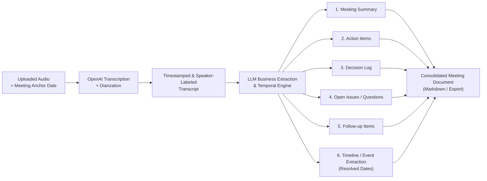

# Product Description: Meeting Minutes Assistant (MVP)

> **Cập nhật kiến trúc audio:** Các mô tả Whisper, timestamp theo từ và chia chunk bên dưới là kế hoạch/lịch sử cũ. Pipeline hiện tại dùng một request `gpt-4o-transcribe-diarize`, transcript v2 theo segment; xem [audio service API](audio-service-api.md). Các phần App/LLM vẫn cần tích hợp và kiểm chứng riêng.

- **Document Version:** 1.2
- **Status:** Approved / In Progress
- **Target Milestone:** Minimum Viable Product (MVP)
- **Repository:** `se2026-t15`

---

## 1. Product Overview & Vision

### 1.1 Executive Summary
The **Meeting Minutes Assistant** is an intelligent meeting productivity tool designed to convert uploaded meeting audio into structured, accurate, and actionable documentation.

By leveraging a single OpenAI transcription and diarization model and LLM-driven business extraction, the product eliminates manual note-taking friction, preserves critical organizational memory, and ensures transparent team alignment.

### 1.2 Core Problem Statement
* **Information Loss:** Crucial decisions, upcoming milestone commitments, and assigned deliverables discussed verbally are frequently forgotten.
* **Distracted Attendees:** Meeting participants spend time taking fragmented notes instead of actively engaging in the discussion.
* **Ambiguous Ownership:** Teams often leave meetings without a crisp, shared understanding of *who* is responsible for *what*, and *when* it is due.
* **Vague Timelines:** Verbal scheduling commitments (e.g., *"Thứ 6 demo"*, *"Tuần sau deploy"*) are rarely converted into concrete calendar dates, causing slipped deadlines.
* **Lack of Verifiable Context:** Traditional meeting summaries lack exact timestamps, making it difficult to trace why or when a decision was made.

### 1.3 Value Proposition
* **Audio Upload:** Submit existing meeting audio files for transcription and structured minutes.
* **Verifiable Transcript:** Speaker-labeled transcripts with timestamps allow users to inspect the exact spoken source.
* **High-Signal Business Artifacts:** Automated extraction of 6 core business modules:
  1. Meeting Summary
  2. Action Items
  3. Decision Log
  4. Open Issues / Unresolved Questions
  5. Follow-up Items
  6. Timeline / Event Extraction (Temporal Resolution to concrete dates)

---

## 2. MVP Scope & Technical Boundaries

### 2.1 In-Scope (MVP)
1. **Audio Ingestion:**
   * Direct audio upload up to 100 MB per file (MP3, M4A, WAV, WebM).
   * Meeting metadata capture (Meeting Title, Anchor Date / Date of the Meeting).
2. **Audio Transcription & Attribution:**
   * Transcription and speaker labeling by **gpt-4o-transcribe-diarize**.
   * Speaker labeling (Speaker 1, Speaker 2, or participant tags).
   * Segment-level timestamps on the source timeline.
3. **Structured Business Output Generation:**
   * Extraction and formatting of all 6 defined business modules.
   * Temporal date resolution (converting relative statements like *"thứ 6 demo"* to exact dates based on the meeting anchor date).
   * Exportable meeting documentation (Markdown / structured JSON / formatted view).

### 2.2 Out-of-Scope (Post-MVP Considerations)
* Real-time live streaming transcription during the meeting.
* In-browser or microphone recording; users provide existing audio files through upload.
* Direct integration with calendar platforms (Google Calendar, Outlook) and video conferencing bots (Zoom/Meet/Teams bot joins).
* Automated direct integration with project management tools (e.g., auto-creating Jira tickets or Trello cards).
* Complex biometric voice-print training.

---

## 3. System Workflow & Data Pipeline



1. **Ingest & Context:** User uploads an existing audio file and supplies meeting context (specifically the **Meeting Anchor Date**, e.g., `05/10/2026`).
2. **Transcribe & Tag:** Audio is processed using `gpt-4o-transcribe-diarize` to yield transcripts with segment timestamps and speaker attribution.
3. **Extract & Resolve:** The timestamped transcript and meeting anchor date are passed to the business intelligence extraction prompt to produce structured JSON for all 6 modules.
4. **Deliver:** The user receives a comprehensive Meeting Minutes Document with all business modules cleanly formatted.

---

## 4. Deep Dive: Core Business Modules Covered

To avoid ambiguity, ensure consistent extraction, and provide high utility, the MVP covers six business modules. Each module has a distinct definition, purpose, schema, and extraction boundary.

---

### Module 1: Meeting Summary
* **Purpose:** Provide an executive-level overview of the meeting so team members or absent stakeholders can grasp the core discussions and outcomes in under 2 minutes.
* **Key Components:**
  * **Meeting Context:** Title, Date, Duration, Participant list.
  * **Executive Overview:** 2–3 concise paragraphs summarizing the primary themes and outcomes.
  * **Core Discussion Pillars:** Bullet points highlighting the central topics debated or presented.
* **Output Schema:**
  ```json
  {
    "title": "String",
    "date": "YYYY-MM-DD",
    "duration_minutes": "Number",
    "participants": ["String"],
    "overview": "String",
    "key_topics": [
      {
        "topic": "String",
        "brief_discussion": "String"
      }
    ]
  }
  ```

---

### Module 2: Action Items
* **Purpose:** Capture clear, assignable, and accountable operational tasks committed during the meeting.
* **Criteria:** Must be a specific task, have an identifiable owner (or role), and have a clear expected deliverable (with deadline if mentioned).
* **Extraction Rules:**
  * If a person verbally commits (*"I will write the API spec by Friday"*), it is an Action Item.
  * Must reference the timestamp where the commitment was stated.
* **Output Schema:**
  ```json
  [
    {
      "id": "ACT-001",
      "task": "Draft OpenAPI specification for meeting ingestion endpoint",
      "owner": "Alex",
      "due_date": "2026-10-10 or null",
      "priority": "High | Medium | Low",
      "source_timestamp": "00:14:22",
      "context": "Follows the discussion regarding audio payload limits"
    }
  ]
  ```

---

### Module 3: Decision Log
* **Purpose:** Record settled choices, architectural directions, or policy agreements so that decisions are not reopened without cause.
* **Criteria:** A topic where consensus or an authoritative choice was made.
* **Extraction Rules:**
  * Distinguish decisions from proposals or opinions. A decision requires explicit agreement or team consensus.
  * Capture the *rationale* behind why this option was chosen over alternatives.
* **Output Schema:**
  ```json
  [
    {
      "id": "DEC-001",
      "decision": "Use OpenAI Whisper API for speech-to-text processing",
      "rationale": "High transcription accuracy, segment timestamps support, and faster time-to-market for MVP",
      "alternatives_considered": "Self-hosted Whisper on AWS EC2, Google Cloud Speech-to-Text",
      "source_timestamp": "00:08:45"
    }
  ]
  ```

---

### Module 4: Open Issues / Unresolved Questions
* **Purpose:** Track unresolved debates, unanswered questions, blockers, and uncertainties that require further investigation before a decision can be reached.
* **Criteria:** Any problem raised where the team explicitly concluded "we don't know yet", "we need more data", or where participants disagreed without reaching a conclusion.
* **Extraction Rules:**
  * Must clearly articulate what information or clarification is missing.
* **Output Schema:**
  ```json
  [
    {
      "id": "ISS-001",
      "issue_or_question": "How will speaker diarization handle overlapping speakers in Whisper API?",
      "raised_by": "Maria",
      "blocker_severity": "High | Medium | Low",
      "status": "Unresolved",
      "source_timestamp": "00:23:10"
    }
  ]
  ```

---

### Module 5: Follow-up Items
* **Purpose:** Capture coordination points, upcoming check-ins, asynchronous reviews, external dependencies, or agenda topics deferred to the next session.
* **Extraction Rules (Distinction Boundary):**
  * *Action Item vs. Follow-up Item:* An Action Item is a direct personal task (*"Bob builds the script"*). A Follow-up Item is a tracking/monitoring point or scheduled sync (*"Check status with DevOps next Tuesday"*, *"Revisit budget after Q3 numbers arrive"*).
  * *Open Issue vs. Follow-up Item:* An Open Issue is an unresolved blocker/question. A Follow-up Item is the concrete process step planned to address an area later.
* **Output Schema:**
  ```json
  [
    {
      "id": "FLW-001",
      "item": "Revisit diarization accuracy benchmarks once test dataset is gathered",
      "responsible_party": "Core Dev Team",
      "target_trigger_or_date": "Next sprint planning (2026-10-12)",
      "source_timestamp": "00:31:05"
    }
  ]
  ```

---

### Module 6: Timeline / Event Extraction (Temporal Resolution)
* **Purpose:** Extract all project milestones, event schedules, release dates, and deadlines discussed verbally in the meeting, and convert relative temporal expressions into **concrete calendar dates**.
* **Scope Definition:**
  * This is **NOT** the chronological duration/runtime of the meeting audio (e.g. 00:00 - 05:00).
  * This is the **Project Timeline & Milestones** stated by participants during the meeting.
* **Temporal Resolution Logic:**
  * Takes the **Meeting Anchor Date** (e.g., `05/10/2026`).
  * Identifies relative spoken phrases:
    * *"Thứ 6 demo"* -> calculates the coming Friday date (`09/10/2026` or `08/10/2026` based on calendar).
    * *"Tuần sau deploy"* -> calculates the target date/week (`12/10/2026`).
    * *"Cuối tháng submit report"* -> calculates the end-of-month date (`31/10/2026`).
* **Output Format:**
  * Chronologically ordered sequence of milestones/events:
    * `05/10/2026` — Meeting (Anchor)
    * `08/10/2026` — Demo
    * `12/10/2026` — Deployment
* **Output Schema:**
  ```json
  [
    {
      "id": "EVT-000",
      "event": "Meeting (Anchor)",
      "resolved_date": "2026-10-05",
      "source_timestamp": "00:00:00"
    },
    {
      "id": "EVT-001",
      "event": "Demo",
      "resolved_date": "2026-10-08",
      "raw_statement": "Thứ 6 demo",
      "source_timestamp": "00:19:40"
    },
    {
      "id": "EVT-002",
      "event": "Deployment",
      "resolved_date": "2026-10-12",
      "raw_statement": "Tuần sau deploy",
      "source_timestamp": "00:24:15"
    }
  ]
  ```

---

### Summary Distinction Matrix

| Module | Core Question Answered | Typical Spoken Cue | Concrete Example |
| :--- | :--- | :--- | :--- |
| **1. Meeting Summary** | What was the meeting about at a high level? | *"Hôm nay team họp để thống nhất kiến trúc MVP..."* | Executive overview paragraph |
| **2. Action Items** | Who must do what specific task and by when? | *"Alex sẽ viết API spec trước thứ 6..."* | Alex: Draft OpenAPI schema |
| **3. Decision Log** | What was conclusively agreed upon and why? | *"Chốt dùng Whisper API vì tốc độ và độ chính xác..."* | Decided: Use Whisper API for MVP |
| **4. Open Issues** | What is still blocked, unknown, or unanswered? | *"Vấn đề rate limit khi audio dài vẫn chưa có cách giải quyết..."* | Unresolved Whisper 25MB file limit handling |
| **5. Follow-up Items** | What external dependency or review is queued? | *"Tuần sau kiểm tra lại sau khi team DevOps gửi config..."* | Review DevOps infrastructure updates next week |
| **6. Timeline / Event Extraction** | What is the project schedule/milestone roadmap? | *"Thứ 6 demo", "Tuần sau deploy"* | `05/10`: Meeting<br/>`08/10`: Demo<br/>`12/10`: Deployment |

---

## 5. Technical Considerations & Alignment

1. **OpenAI transcription and diarization:**
   * `gpt-4o-transcribe-diarize` returns speaker-labeled segments and segment timestamps in one request.
   * Model speaker labels are inferred, not verified identities; the model is scheduled to shut down on 26/02/2027.
2. **Temporal Resolution Engine:**
   * Prompts provide the current meeting date (`anchor_date`) to the LLM.
   * The LLM applies temporal parsing rules (ISO 8601 date resolution) for Vietnamese and English expressions (e.g., *"thứ 6 này"*, *"tuần sau"*, *"cuối tháng"*, *"next Tuesday"*).
3. **File size:**
   * Encode the full audio to MP3 and reject provider payloads at or above 24 MB; do not split it into independent diarization requests.
4. **Structured Document Output:**
   * Stores meeting artifacts in structured JSON and renders to clean, shareable Markdown and HTML/PDF exports.
